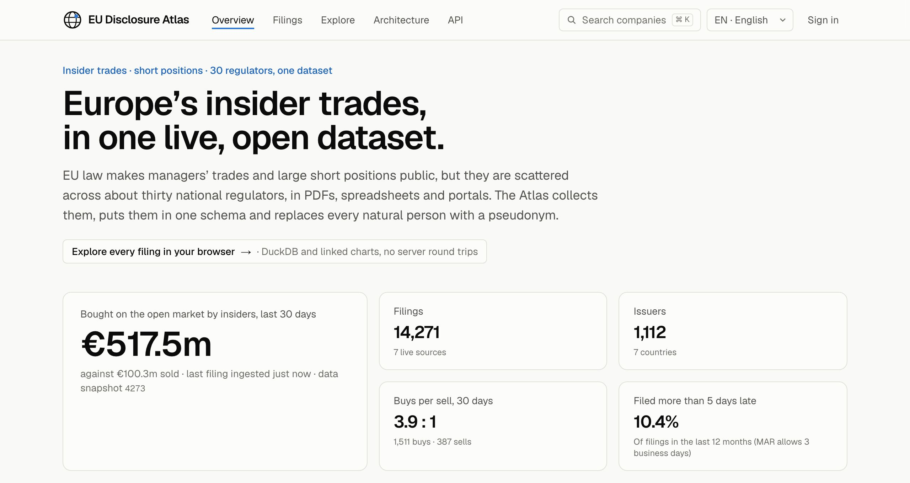

# EU Disclosure Atlas

**Open, unified, research-grade data on insider trading and short selling across European markets: a live
website, a public API and versioned open data.**

[](https://github.com/Manuelma4/eu-disclosure-atlas/actions/workflows/ci.yml)



In the United States, every insider trade is filed on SEC Form 4 within two business days and is free,
structured and searchable on EDGAR. A whole ecosystem of academic research, retail tools and journalism is
built on that data.

In the European Union, the same information is **public by law**, but it is **practically inaccessible**:

| | United States | European Union |
|---|---|---|
| Insider trades | SEC Form 4, one database (EDGAR), XML, free API | MAR Article 19 notifications, published by ~30 national authorities (EU-27 + EEA) |
| Short positions | FINRA short interest, twice a month | SSR Article 6 net short positions >= 0.5%, one website per authority |
| Format | Machine-readable, one schema | PDF, Excel, CSV, HTML; different languages, identifiers and retention (e.g. one year in BaFin's database) |
| Free unified dataset | Yes | **No.** Commercial aggregators only |

The EU's own fix, the European Single Access Point (ESAP), opens in July 2027 and reaches full scope only in
January 2030. It centralises access to filings, not a harmonised, research-ready time series.

## Why now

- **The SEC now relies on these filings.** The Holding Foreign Insiders Accountable Act (adopted 18 December
  2025) extended Section 16(a) insider reporting to directors and officers of foreign private issuers from
  18 March 2026. On 5 March 2026, the SEC conditionally exempted insiders who report under "substantially
  similar" regimes and treated MAR Article 19 as one for EEA issuers, provided the filings are public in
  English within two business days. The AMF now publishes French declarations in French and English
  ([AMF, 28 August 2026](https://www.amf-france.org/fr/actualites-publications/actualites/lamf-publie-desormais-les-declarations-des-dirigeants-en-francais-et-en-anglais)).
  For many dual-listed European companies, MAR filings now play the role of Form 4, but there is no EDGAR for them.
- **A natural experiment is running.** The EU Listing Act (Regulation (EU) 2024/2809) raised the baseline
  PDMR notification threshold from EUR 5,000 to EUR 20,000 per year and lets each authority choose between
  EUR 10,000 and EUR 50,000. Thirty jurisdictions, different thresholds and the same rules otherwise make it a
  clean setting for policy evaluation.

## The platform

| Surface | What it does | Status |
|---|---|---|
| **Website** | Live tape of new filings, insider flow, largest buys, company pages, filings explorer, architecture | Live (Next.js 16.4) |
| **REST API `/v1`** | Filings, issuers, statistics; OpenAPI 3.1, cursor pagination, ETags pinned to data snapshots | Live (FastAPI) |
| **Live stream `/v1/stream`** | Server-sent events for every newly ingested filing, resumable; fanned out from Kafka by a Go gateway | Live |
| **Open data** | Gold tables as Parquet (`disclosure-atlas export`), daily releases next | Partial |
| **MCP server** | Tools and MCP Apps so AI agents can query the dataset | Planned (P4) |
| **Alerts and webhooks** | Sign-in (Keycloak, passkeys), watchlists, email and Standard Webhooks with retries (Go service on Kafka) | Live (local stack) |

Under the hood: connectors per regulator → a medallion lakehouse (bronze, silver, gold) → snapshot-pinned read
models → REST, SSE and a website whose cache is invalidated by data commits. AI-assisted extraction reads
PDF-only sources with an evaluation gate. Full design: [docs/architecture.md](docs/architecture.md), decisions:
[docs/decisions/](docs/decisions/).

| Layer | Choice |
|---|---|
| Website | Next.js 16.4 (React 19.3, Cache Components), TypeScript, Tailwind CSS v4, typed client generated from OpenAPI |
| API | Python 3.14, FastAPI, Pydantic v2, OpenAPI 3.1, SSE, RFC 9457 errors |
| Data | DuckDB 1.5 on Parquet today, DuckLake 1.0 (PostgreSQL 18 catalog, Cloudflare R2) next |
| Pipeline | Connector plugins today, Dagster 1.13 assets, sensors and checks next |
| Services | Python (ingestion, extraction, query-api, ai-service), Go (realtime-gateway, alerts), TypeScript (web) |
| Events | Apache Kafka 4 (KRaft) with a schema registry, CloudEvents contracts, retry and dead-letter topics |
| Platform | Kubernetes, Helm, Argo CD (GitOps), KEDA, Strimzi, CloudNativePG, OpenTofu on Scaleway (EU) |
| Security | Keycloak (OIDC, passkeys), Envoy Gateway, signed images, SBOM, threat model |
| Observability | OpenTelemetry, Prometheus, Loki, Tempo, Grafana, SLOs as code, Langfuse, MLflow |
| AI | Claude API or local Ollama for extraction and questions, MCP for agents, evaluation gates in CI |

## Coverage

| Jurisdiction | Authority | Insider trades (MAR 19) | Net short positions (SSR) |
|---|---|---|---|
| Sweden | Finansinspektionen | **Live** (`se_fi_pdmr`) | Planned |
| France | AMF (BDIF) | In progress: PDF + AI extraction | Planned |
| Germany | BaFin | Planned | Planned |
| Netherlands | AFM | Planned | Planned |
| Spain, Italy, Nordics, others | | Researching | Researching |

Status and source notes: [docs/sources/README.md](docs/sources/README.md). Plan: [ROADMAP.md](ROADMAP.md).

## Run it

```bash
# Data and API (Python 3.14)
python3.14 -m venv .venv && source .venv/bin/activate
pip install -e '.[dev,api]'
pytest                                                    # offline test suite
disclosure-atlas reference fx                             # ECB euro reference rates
disclosure-atlas ingest se_fi_pdmr --start 2026-04-20     # six months of Swedish filings into ./lake
disclosure-atlas serve                                    # API on http://127.0.0.1:8000, docs at /docs
disclosure-atlas watch se_fi_pdmr                         # optional: re-ingest every 5 minutes

# Website (Node.js 22 or later)
cd web && npm install && npm run dev                      # http://localhost:3000
```

Run the event-driven platform locally (Kafka, PostgreSQL, Keycloak, the Go realtime-gateway and alerts):

```bash
pip install -e '.[dev,api,events]'
docker compose -f infra/compose.yaml up -d --build        # Keycloak demo account: demo@example.org / demo-dev-only
ATLAS_KAFKA_BOOTSTRAP=localhost:19092 ATLAS_SCHEMA_REGISTRY_URL=http://localhost:18081 \
  disclosure-atlas watch se_fi_pdmr                       # new filings → atlas.filings.v1
cd web && NEXT_PUBLIC_ATLAS_STREAM_URL=http://localhost:8090 npm run dev   # live tape via the gateway; sign in → Watchlist
```

Alert emails land in Mailpit (http://localhost:8025); webhooks can target the dev sink
(`http://webhook-sink:8099/hook`, received payloads on http://localhost:8099/deliveries).

Query the data directly:

```bash
disclosure-atlas query "
  SELECT transaction_date, issuer_name, pdmr_role, round(amount_eur / 1e6, 1) AS m_eur
  FROM insider_transactions WHERE is_open_market AND nature = 'buy'
  ORDER BY amount_eur DESC LIMIT 10"
disclosure-atlas export --out exports                     # gold tables as Parquet
```

## Research agenda

Do European insiders beat the market? Do funds keep short positions just below the 0.5% publication threshold?
Did the Listing Act threshold change disclosure? How late are filings, country by country? See
[docs/research-agenda.md](docs/research-agenda.md).

## Privacy, terms and disclaimer

Managers are natural persons. Their names never enter the silver or gold layers: each person becomes a keyed,
per-issuer pseudonym. Legal entities, such as holding companies of closely associated persons, keep their
names. Raw files stay in the private bronze layer and are not redistributed. Every source is crawled politely
and its terms are documented. See [docs/legal-and-ethics.md](docs/legal-and-ethics.md).

This is a research and transparency project. **Nothing here is investment advice.**

## Author

Built by [Manuel David Maya Rosero](https://manuelma4.github.io/), a software engineer in Paris working on data
platforms, applied AI and the economics of digital markets and regulation.

Code: [Apache-2.0](LICENSE). Data: subject to each source's terms; see [docs/sources/](docs/sources/).
