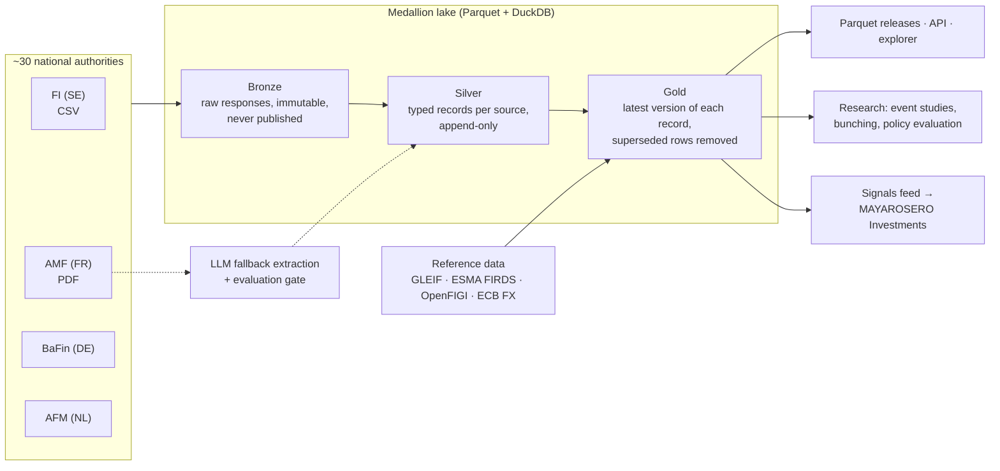

# EU Disclosure Atlas

**Open, unified, research-grade data on insider trading and short selling across European markets.**

[](https://github.com/Manuelma4/eu-disclosure-atlas/actions/workflows/ci.yml)

In the United States, every insider trade is filed on SEC Form 4 within two business days and is free,
structured and searchable on EDGAR. A whole ecosystem of academic research, retail tools and journalism is
built on that data.

In the European Union, the same information is **public by law**, but it is **practically inaccessible**:

| | United States | European Union |
|---|---|---|
| Insider trades | SEC Form 4, one database (EDGAR), XML, free API | MAR Article 19 notifications, published by ~30 national authorities (EU-27 + EEA) |
| Short positions | FINRA short interest, twice a month | SSR Article 6 net short positions >= 0.5%, one website per authority |
| Format | Machine-readable, one schema | PDF, Excel, CSV, HTML; different languages, identifiers and retention (e.g. one year in BaFin's database) |
| Free unified dataset | Yes | **No.** Commercial aggregators only |

The EU's own fix, the European Single Access Point (ESAP), opens in July 2027 and reaches full scope only in
January 2030. It centralises access to filings, not a harmonised, research-ready time series.

## Why now

- **The SEC now relies on these filings.** The Holding Foreign Insiders Accountable Act (adopted 18 December
  2025) extended Section 16(a) insider reporting to directors and officers of foreign private issuers from
  18 March 2026. On 5 March 2026, the SEC conditionally exempted insiders who report under "substantially
  similar" regimes and treated MAR Article 19 as one for EEA issuers, provided the filings are public in
  English within two business days. The AMF now publishes French declarations in French and English
  ([AMF, 28 August 2026](https://www.amf-france.org/fr/actualites-publications/actualites/lamf-publie-desormais-les-declarations-des-dirigeants-en-francais-et-en-anglais)).
  For many dual-listed European companies, MAR filings now play the role of Form 4, but there is no EDGAR for them.
- **A natural experiment is running.** The EU Listing Act (Regulation (EU) 2024/2809) raised the baseline
  PDMR notification threshold from EUR 5,000 to EUR 20,000 per year and lets each authority choose between
  EUR 10,000 and EUR 50,000. Thirty jurisdictions, different thresholds and the same rules otherwise make it a
  clean setting for policy evaluation.

## What this project builds

1. **Connectors** for each national authority, one module per source, with provenance for every byte.
2. **One schema** for all of Europe, based on the EU notification template (Implementing Regulation (EU)
   2016/523) and the SSR disclosure fields. See [docs/data-model.md](docs/data-model.md).
3. **AI-assisted extraction** for PDF-only sources (France first): deterministic parsing first, then an LLM
   fallback with schema-constrained output, gated by a hand-labelled evaluation set in CI.
4. **Entity resolution:** issuers and holders to LEI (GLEIF), instruments to ISIN and issuer (ESMA FIRDS),
   tickers (OpenFIGI), amounts in EUR (ECB reference rates).
5. **Research**, reproducible end to end. Do European insiders beat the market? Do funds keep short positions
   just below the 0.5% publication threshold? Did the Listing Act threshold change disclosure? See
   [docs/research-agenda.md](docs/research-agenda.md).
6. **Access:** open Parquet releases, a DuckDB file, a Python CLI, a read-only API, a static explorer and a
   signals feed (insider cluster buys, crowded shorts) for
   [MAYAROSERO Investments](https://github.com/Manuelma4/MAYAROSERO-Investments).

## Coverage

| Jurisdiction | Authority | Insider trades (MAR 19) | Net short positions (SSR) |
|---|---|---|---|
| Sweden | Finansinspektionen | **Live** (`se_fi_pdmr`) | Planned |
| France | AMF (BDIF) | Planned: PDF + AI extraction | Planned |
| Germany | BaFin | Planned | Planned |
| Netherlands | AFM | Planned | Planned |
| Spain, Italy, Nordics, others | | Researching | Researching |

Status and source notes: [docs/sources/README.md](docs/sources/README.md). Plan: [ROADMAP.md](ROADMAP.md).

## Quickstart

```bash
python3.12 -m venv .venv && source .venv/bin/activate
pip install -e '.[dev]'
pytest                                                    # offline test suite

disclosure-atlas sources                                  # registered connectors
disclosure-atlas ingest se_fi_pdmr --start 2026-10-01     # fetch + parse into ./lake
disclosure-atlas stats
disclosure-atlas query "
  SELECT transaction_date, issuer_name, pdmr_role, round(amount / 1e6, 1) AS m_sek
  FROM insider_transactions
  WHERE is_open_market AND nature = 'buy' AND currency = 'SEK'
  ORDER BY amount DESC LIMIT 10"
disclosure-atlas export --out exports                     # gold tables as Parquet
```

## Architecture



Details and design decisions: [docs/architecture.md](docs/architecture.md), [docs/decisions/](docs/decisions/).

## Privacy, terms and disclaimer

Managers are natural persons. Their names never enter the silver or gold layers: each person becomes a keyed,
per-issuer pseudonym. Legal entities, such as holding companies of closely associated persons, keep their
names. Raw files stay in the private bronze layer and are not redistributed. Every source is crawled politely
and its terms are documented. See [docs/legal-and-ethics.md](docs/legal-and-ethics.md).

This is a research and transparency project. **Nothing here is investment advice.**

## Author

Built by [Manuel David Maya Rosero](https://manuelma4.github.io/), a software engineer in Paris working on data
platforms, applied AI and the economics of digital markets and regulation.

Code: [Apache-2.0](LICENSE). Data: subject to each source's terms; see [docs/sources/](docs/sources/).
