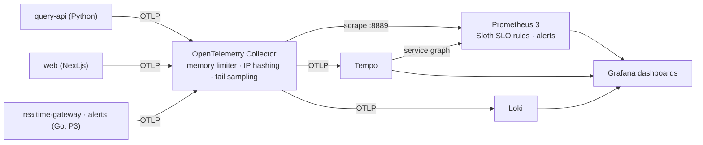

# Observability (P7)

Telemetry, SLOs and dashboards as code for EU Disclosure Atlas, following decision
[0014](../../docs/decisions/0014-observability-slos-and-mlops.md). Services export OpenTelemetry (OTLP) to a
Collector, which sends metrics to Prometheus, traces to Tempo and logs to Loki; Grafana ties them together
(exemplars from latency panels open traces, trace ids in logs open traces, traces open their logs).



## Run it locally
```bash
docker compose -f infra/compose.yaml -f deploy/observability/compose.yaml up -d otel-collector prometheus loki tempo grafana
```
```bash
pip install -e '.[api,otel]' && OTEL_EXPORTER_OTLP_ENDPOINT=http://localhost:4318 disclosure-atlas serve
```
Or run everything in containers on a synthetic lake (no local lake needed):
```bash
docker compose -f infra/compose.yaml -f deploy/observability/compose.yaml --profile app up -d
```
Open Grafana at <http://localhost:3030> (folder *EU Disclosure Atlas*), Prometheus at <http://localhost:9090>
(*Alerts* shows every SLO alert). For the website, set the same `OTEL_EXPORTER_OTLP_ENDPOINT` before
`npm run start`; its fetches to the API propagate trace context, so a page render and its DuckDB queries share
one trace. Telemetry is off whenever `OTEL_EXPORTER_OTLP_ENDPOINT` is unset.

## Signals (the metric contract)
Names as Prometheus sees them after the Collector; `job` is the OpenTelemetry `service.name`. Other services
(P3's Go services included) should emit the same names so the SLOs and dashboards cover them unchanged.

| Metric | Type | Labels | Emitted by | Used by |
|---|---|---|---|---|
| `http_server_request_duration_seconds` | histogram, buckets include 0.2 | `http_route`, `http_request_method`, `http_response_status_code` | FastAPI instrumentation (stable HTTP semconv) | API SLOs, RED dashboard |
| `atlas_db_query_duration_seconds` | histogram | `db_operation_name`, `error_type` | query API (DuckDB spans) | RED dashboard |
| `atlas_source_filings_total` | counter | `source`, `timeliness` = `on_time` (≤15 min), `late`, `backfill` (>1 day) | query API, computed from gold | freshness SLO |
| `atlas_source_last_ingested_seconds`, `atlas_source_last_published_seconds` | gauge (Unix time) | `source` | query API, from gold | `AtlasSourceStale`, freshness dashboard |
| `atlas_stream_clients` | gauge | | query API stream; realtime-gateway (P3) | real-time dashboard |
| `atlas_stream_events_total` | counter | | same | real-time dashboard |
| `atlas_stream_event_delay_seconds` | histogram, buckets include 5 | | same (gateway: from the Kafka record timestamp) | live-event SLO |

Traces: one server span per request with `SELECT gold` client spans for each DuckDB query (SQL text, never
parameters). Logs: Python logging is shipped with the active trace id.

## SLOs as code
Specs in [`slos/`](slos/) (Sloth, `prometheus/v1`), generated rules in [`prometheus/rules/`](prometheus/rules/).
Regenerate after editing a spec (CI fails on drift):
```bash
docker run --rm -v "$PWD/deploy/observability":/w -w /w ghcr.io/slok/sloth:v0.12.0 generate -i slos -o prometheus/rules
```

| SLO | Objective | SLI | Alerts |
|---|---|---|---|
| `query-api/requests-availability` | 99.9% / 30 d | `/v1` responses that are not 5xx (stream excluded) | page + ticket burn rates |
| `query-api/requests-latency` | 95% / 30 d | `/v1` responses within 200 ms (p95 under 200 ms) | page + ticket |
| `ingestion/filing-freshness` | 95% / 30 d, per source | filings visible within 15 minutes of publication | page + ticket, per `source` |
| `realtime/event-delay` | 99% / 30 d | live events delivered within 5 seconds | page + ticket |

Multi-window, multi-burn-rate alerts: page at 14.4× (1 h and 5 min) or 6× (6 h and 30 min); ticket at 3×
(1 d and 2 h) or 1× (3 d and 6 h). Hand-written symptom alerts live in
[`prometheus/rules/atlas-alerts.yaml`](prometheus/rules/atlas-alerts.yaml). Every alert has a `runbook_url`
into [`docs/runbooks/`](../../docs/runbooks/).

Freshness "95% of business hours" is measured per filing: regulators publish during their business hours, so
counting filings weights those hours without encoding each country's calendar in PromQL. A source that goes
silent is caught by `AtlasSourceStale` instead.

## Dashboards as code
[`grafana/dashboards.py`](grafana/dashboards.py) generates the JSON in `grafana/dashboards/` (plain Python,
no dependencies; CI fails on drift): *Query API: RED*, *Ingestion: freshness per source*, *Real time: SSE
clients and event delay*, *Kafka: consumer lag* (placeholder until P3's consumers run), *SLO overview*.

## Sampling and privacy
The Collector keeps every error trace and every trace slower than 200 ms, plus 10% of the rest (tail
sampling). It hashes `client.address` and drops authorization, cookie and API-key headers before anything is
stored. In Kubernetes, a routing tier load-balances spans by trace id in front of the sampling tier
([`helm/otel-collector-values.yaml`](helm/otel-collector-values.yaml)).

## Kubernetes hand-off (P6)
[`helm/`](helm/) holds values snippets for the charts P6 owns: OTLP environment for `query-api` and `web`,
the Collector routing tier, and kube-prometheus-stack settings (remote-write receiver, exemplars, rule and
dashboard discovery). [`chaos/`](chaos/) holds Chaos Mesh experiments for the preview cluster: pod kill,
injected latency that should trip the latency alert, and a Kafka partition for the realtime-gateway.
