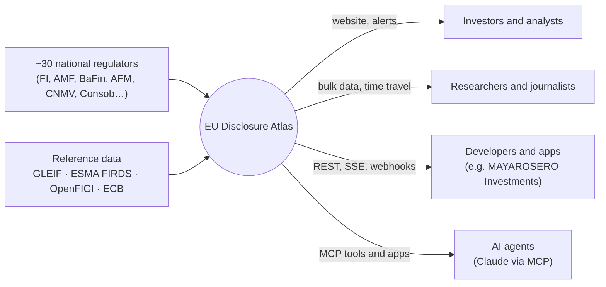
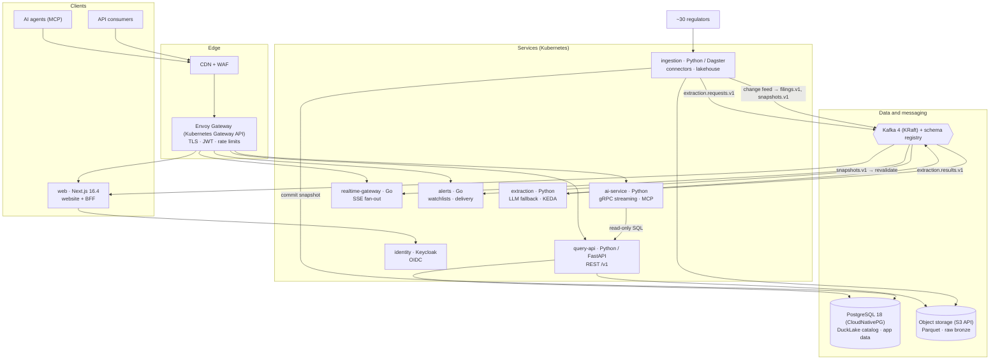
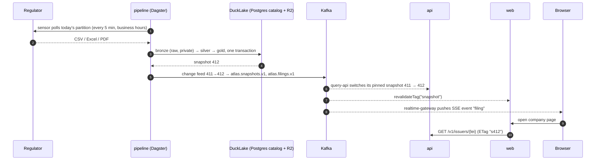

# Platform architecture

EU Disclosure Atlas is a public web platform and open-data product: a website, a public REST API, a real-time
feed, an MCP server for AI agents, and versioned bulk data, all built on one data pipeline. This document
explains the design. The choices are recorded with alternatives in [decisions/](decisions/).

## Principles
1. **The lake is the system of record.** Everything else (API read paths, caches, events, search, alerts) is a
   projection that can be rebuilt from it. Losing a message or a cache is an inconvenience, not data loss.
2. **Immutable, versioned data.** Every commit to the lake creates a snapshot. Reads are pinned to a snapshot,
   so responses are consistent, cacheable by snapshot id, and reproducible for research ("as of snapshot 412").
3. **Events, not polling, between components.** A committed snapshot emits domain events; the website cache,
   live feed, alerts and webhooks react to them.
4. **Dogfood the public API.** The website is a client of the same REST API that third parties use.
5. **Each language where it is strongest.** Python for data, extraction, research and the API; TypeScript for
   the web. One Python codebase with several deployables (a modular monolith), not a microservice sprawl.
6. **Privacy by design.** Natural persons are pseudonyms everywhere outside the private bronze layer.
7. **Cheap to run, easy to fork.** Files, SQL and a few small processes; a full stack runs on one laptop.

## System context

## Services (v2: microservices by bounded context)

| Service | Technology | Responsibility | Scales on |
|---|---|---|---|
| `web` | Next.js 16.4, React 19.3, TypeScript, Tailwind CSS v4 | Website and backend-for-frontend | Requests (edge or pods) |
| `query-api` | Python 3.14, FastAPI, DuckDB 1.5 | Public REST `/v1`, read models pinned to snapshots | CPU behind the CDN |
| `ai-service` | Python, Claude API or Ollama, gRPC, MCP | Ask the Atlas, filing explainer, MCP tools and apps | Concurrent model calls |
| `realtime-gateway` | Go | Server-sent events from Kafka to browsers, resumable | Open connections |
| `alerts` | Go, PostgreSQL | Watchlists, alert rules, email / Web Push / webhooks with retry topics | Kafka consumer lag (KEDA) |
| `ingestion` | Python 3.14, Dagster 1.13 | Connectors, bronze → silver → gold, DuckLake commits, change-feed publishing | Dagster run workers |
| `extraction` | Python | LLM extraction of PDF filings with evaluation gates | Kafka consumer lag (KEDA) |
| `identity` | Keycloak | Users (passkeys), OIDC clients, partner API clients | Replicas |
| Kafka 4 (KRaft) | Strimzi; Redpanda locally | Event backbone, retry and dead-letter topics, schema registry | Partitions |
| PostgreSQL 18 | CloudNativePG | DuckLake catalog, accounts, watchlists, Dagster storage | Primary + replicas |
| Object storage | Scaleway Object Storage / R2; local disk in dev | Parquet data files, private raw bronze, open-data releases | Managed |

Decision records: [0010](decisions/0010-microservices-by-bounded-context.md) (service boundaries),
[0011](decisions/0011-kafka-event-streaming-with-schema-registry.md) (events).

## Data flow: from a regulator's website to your screen

Freshness target: a filing appears on the website within 15 minutes of publication by the regulator, during
the regulator's business hours (measured per source and shown on the status page).

## Lakehouse
- **Format: DuckLake 1.0** (April 2026). The catalog is a set of tables in PostgreSQL, data files are Parquet
  on object storage, and every commit is an ACID snapshot. Frequent small commits (a few new filings every
  few minutes) are cheap thanks to data inlining, the problem file-based catalogs handle worst.
- **Layers:** `bronze` (raw responses, private), `silver` (typed records per source, append-only), `gold`
  (latest version per record, superseded rows removed, enriched, derived signals). See
  [data-model.md](data-model.md).
- **Time travel** makes research reproducible: every figure in a research note cites the snapshot it used.
- **Change feed:** the difference between two snapshots (`table_changes`) yields exactly the new and changed
  gold rows, which become `filing.published` events. No diffing code, no polling.
- **Openness:** gold tables are exported daily as plain Parquet with a Frictionless `datapackage.json`, so
  anyone can query Europe's insider trades with one DuckDB line, no account needed.
- The current M0 code uses the same layers on local Parquet files with DuckDB views; migrating to DuckLake is
  workstream P2 and changes no public schema.

## Event streaming (Kafka)
| Topic | Key | Producer | Consumers |
|---|---|---|---|
| `atlas.filings.v1` | issuer LEI | ingestion (change feed) | realtime-gateway, alerts, signal processor |
| `atlas.snapshots.v1` | dataset | ingestion | query-api (snapshot switch), web (revalidation) |
| `atlas.extraction.requests.v1` / `.results.v1` | document hash | ingestion / extraction | extraction / ingestion |
| `atlas.notifications.v1` (+ `.retry.5m`, `.retry.1h`, `.dlq`) | user id | alerts | alerts delivery workers |
| `atlas.signals.v1` | issuer LEI | signal processor (e.g. cluster buys) | alerts, web |

- CloudEvents 1.0 envelopes with JSON payloads whose JSON Schemas are generated from the Pydantic models,
  committed in `contracts/events/` and registered with BACKWARD compatibility.
- **No dual writes:** events come from the lake's change feed between committed snapshots, with a checkpoint
  written after publishing (at-least-once). Producers are idempotent and consumers deduplicate on event ids.
- The lake stays the source of truth: any topic can be rebuilt by replaying snapshots.

## Public interfaces
- **REST `/v1`** (OpenAPI 3.1 generated from the Pydantic models): cursor pagination, filters, RFC 9457
  problem details, `ETag` equal to the snapshot id, `Cache-Control: public, s-maxage=60,
  stale-while-revalidate=600`, `?as_of=<snapshot>` time travel, API keys for higher limits, and deprecation
  through the `Deprecation` and `Sunset` headers.
- **SSE `/v1/stream`:** live filings with `id`, `Last-Event-ID` resume and heartbeats. SSE works through CDNs
  and proxies and needs no client library.
- **Webhooks:** signed with the Standard Webhooks spec (HMAC), retried through Kafka retry topics (5 minutes,
  1 hour) and a dead-letter topic, with a delivery log per endpoint.
- **MCP server** (spec 2026-07-28, stateless): tools such as `search_issuers`, `insider_activity`,
  `short_interest`, `cluster_buys`, `filing_lag_stats` and a read-only `sql`, plus an MCP App that renders an
  issuer's insider timeline inside the chat.
- **Bulk data:** daily Parquet releases, plus read-only DuckLake access for time travel.
- **Typed SDKs** generated from the OpenAPI document: TypeScript (used by the website) and Python.

## Website
- **Next.js 16.4 with Cache Components:** data functions use `"use cache"` with `cacheTag("snapshot")`; the
  `snapshot.committed` event calls `revalidateTag`, so pages are static-fast and fresh within seconds of new
  data. Company pages are server-rendered for search engines, with `schema.org/Dataset` JSON-LD for Google
  Dataset Search.
- **UI:** Tailwind CSS v4 and shadcn/ui; TanStack Query and Table; TradingView lightweight-charts for price
  and insider markers; Observable Plot for statistics.
- **Explorer:** DuckDB-WASM plus Mosaic linked views query the published Parquet directly in the browser,
  with millions of rows and no server cost. The API serves each gold table once per snapshot at
  `/v1/exports/{table}.parquet` with HTTP range requests; DuckDB-WASM and its Parquet extension are self-hosted
  (no third-party requests), and Mosaic pre-aggregates brushes (1.2 million rows: ready in about 3.5 s,
  cross-filter updates in 0.1 to 0.35 s on a laptop).
- **Prices:** `/v1/issuers/{lei}/prices` maps the issuer's share ISIN to a listing and returns daily bars with the
  days its insiders traded, through a pluggable provider cached under `lake/reference/prices/` (see
  [prices.md](prices.md)).
- **Languages:** English, French, Spanish and German (next-intl, locale-prefixed routes, hreflang alternates).
- **Quality gates:** Playwright end-to-end tests (axe accessibility checks in light and dark mode, keyboard flows)
  and Lighthouse budgets run in CI against the real API over a synthetic lake.
- **Accounts** (Better Auth with passkeys and magic links): watchlists, alert rules, API keys and webhook
  endpoints.

## AI layer
- **Extraction** ([decisions/0003](decisions/0003-deterministic-first-extraction-with-evaluated-llm-fallback.md)):
  deterministic parsing first, then an LLM fallback (Claude Haiku-class for cost, or local Ollama),
  schema-validated, with field-level evaluation gates in CI.
- **Ask the Atlas:** natural-language questions become read-only SQL over gold tables. The SQL is parsed
  with sqlglot (no writes, row and time limits, schema allowlist), the answer shows its SQL and a chart, and a
  golden question set gates prompt changes.
- **Filing explainer:** plain-language summary and translation of a filing, citing its fields, streamed to
  the website over gRPC server streaming (Protobuf contracts managed with buf).
- **MCP** (above) makes the whole dataset available to agents with the same guardrails.

## Security and privacy
Details: [0013](decisions/0013-identity-edge-and-application-security.md).
- Keycloak (OIDC): authorization code + PKCE with passkeys for the website, client credentials for partners,
  scoped JWTs validated by every service.
- Envoy Gateway at the edge: TLS, JWT validation, per-client rate limits, size limits, CORS.
- Pseudonymization ([0002](decisions/0002-pseudonymize-natural-persons.md)); bronze in a private bucket;
  personal data redacted from logs; fetchers restricted to an allowlist of regulator hosts (no SSRF).
- Kubernetes: `restricted` Pod Security, default-deny NetworkPolicies, secrets through External Secrets and
  SOPS, Kyverno admitting only signed images.
- Verification in CI: CodeQL, pip-audit, npm audit, govulncheck, Trivy, SBOM (Syft), cosign signatures, and an
  OWASP ZAP baseline scan of each preview environment. Threat model: `docs/security/threat-model.md`.

## Observability, SLOs and MLOps
Details: [0014](decisions/0014-observability-slos-and-mlops.md).
- OpenTelemetry in every service → Collector (tail sampling) → Prometheus, Loki and Tempo; Grafana
  dashboards as code.
- SLOs as code with burn-rate alerts: filing freshness per source (15 minutes, 95% of business hours), `/v1`
  availability 99.9% with p95 under 200 ms, live events within 5 seconds of publication.
- Data observability: Dagster asset checks and OpenLineage lineage. LLM observability: Langfuse traces with
  evaluation scores.
- MLOps: an insider-trade informativeness model with MLflow tracking and registry, walk-forward validation,
  batch scoring in Dagster, a model card and drift monitoring.
- Resilience: k6 load tests with budgets, Chaos Mesh experiments in the preview cluster, and runbooks per alert.

## Delivery
Details: [0012](decisions/0012-kubernetes-gitops-and-infrastructure-as-code.md).
- **Monorepo:**

  | Path | Contents |
  |---|---|
  | `src/disclosure_atlas` | Python shared kernel and Python services |
  | `services/` | Go services |
  | `web/` | Next.js website |
  | `contracts/` | Event JSON Schemas and Protobuf |
  | `deploy/` | Helm charts, Argo CD applications, k3d configuration |
  | `infra/` | Compose and OpenTofu |
  | `research/`, `evals/`, `docs/` | Research studies, evaluation sets, documentation |

- **CI (GitHub Actions, path-filtered per service):**
  - lint and tests;
  - contract checks (OpenAPI drift, event schema compatibility, `buf breaking`);
  - Schemathesis against the API;
  - Playwright end to end;
  - k6 budgets;
  - AI evaluation gates;
  - images built, scanned, given an SBOM, signed and pushed to GHCR.
- **CD:** Argo CD (GitOps) with an app-of-apps per environment and an ephemeral namespace per pull request.
  Production runs on Scaleway Kapsule (EU), declared with OpenTofu. k3d runs the same charts locally and in CI.
- **Releases:** conventional commits and tags created by the owner, with GitHub Releases built from tags. No bot
  commits: the owner is the only contributor, enforced by hooks and a CI check.

## Evolution
| Phase | Scope |
|---|---|
| Done (M0, P1) | Parquet lake, CLI, FastAPI read API with SSE, Next.js website, CI |
| P2 | DuckLake + Dagster, snapshot ids, time travel |
| P3 | Kafka, change-feed publisher, Go realtime-gateway and alerts, Keycloak, Envoy Gateway |
| P4 | ai-service: MCP server, Ask the Atlas, gRPC explainer, evaluation gates |
| P5 | Website product: search, DuckDB-WASM explorer, prices, four languages, end-to-end tests |
| P6 | Kubernetes, Helm, Argo CD, KEDA, operators, OpenTofu on Scaleway, signed supply chain |
| P7 | Observability, SLOs, security hardening, load and chaos tests |
| P8 | MLOps: insider-signal model with MLflow, scoring and monitoring |

## What we deliberately do not use (yet)
- **GraphQL for the public API:** an open-data API benefits more from CDN-cacheable REST, bulk files and SQL.
  GraphQL stays an option for a future authenticated app API.
- **A service mesh:** with eight services, mTLS and retries come from the platform and client libraries; a mesh
  (Linkerd) is the next step if the service count grows.
- **Microservices per connector:** connectors are plugins inside `ingestion` and scale as Dagster runs.
- **A separate search engine:** PostgreSQL full-text search and trigram indexes cover issuer search at this size.
