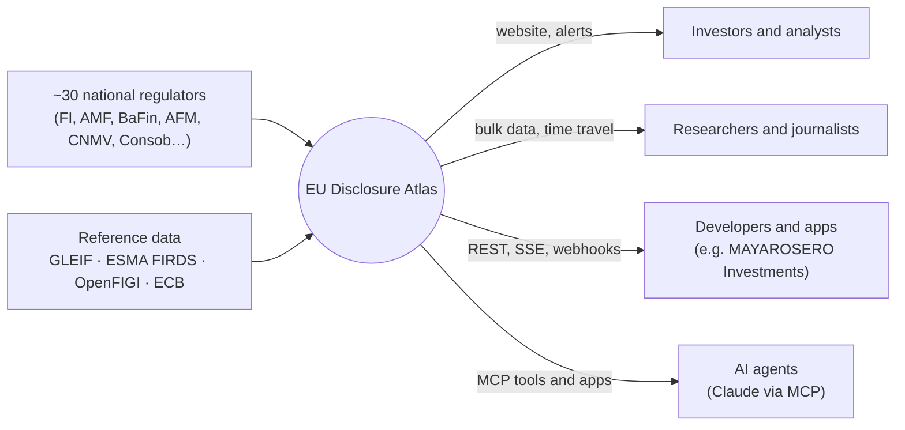
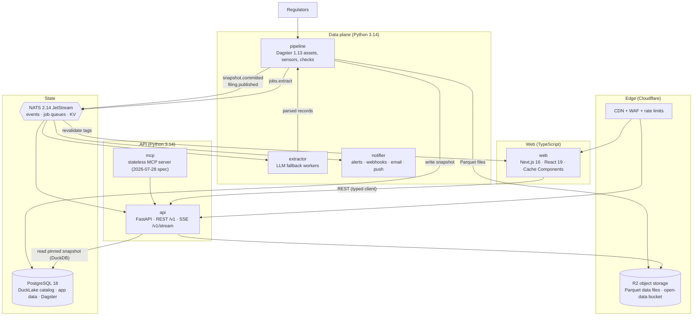
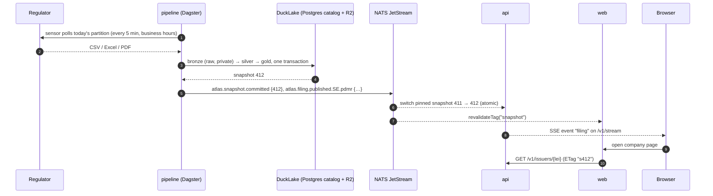

# Platform architecture

EU Disclosure Atlas is a public web platform and open-data product: a website, a public REST API, a real-time
feed, an MCP server for AI agents, and versioned bulk data, all built on one data pipeline. This document
explains the design. The choices are recorded with alternatives in [decisions/](decisions/).

## Principles
1. **The lake is the system of record.** Everything else (API read paths, caches, events, search, alerts) is a
   projection that can be rebuilt from it. Losing a message or a cache is an inconvenience, not data loss.
2. **Immutable, versioned data.** Every commit to the lake creates a snapshot. Reads are pinned to a snapshot,
   so responses are consistent, cacheable by snapshot id, and reproducible for research ("as of snapshot 412").
3. **Events, not polling, between components.** A committed snapshot emits domain events; the website cache,
   live feed, alerts and webhooks react to them.
4. **Dogfood the public API.** The website is a client of the same REST API that third parties use.
5. **Each language where it is strongest.** Python for data, extraction, research and the API; TypeScript for
   the web. One Python codebase with several deployables (a modular monolith), not a microservice sprawl.
6. **Privacy by design.** Natural persons are pseudonyms everywhere outside the private bronze layer.
7. **Cheap to run, easy to fork.** Files, SQL and a few small processes; a full stack runs on one laptop.

## System context

## Containers

| Container | Technology | Responsibility | Scales by |
|---|---|---|---|
| `web` | Next.js 16.4, React 19.3, TypeScript, Tailwind CSS v4 | Public website: live tape, company pages, explorers, research, docs | Edge/serverless |
| `api` | Python 3.14, FastAPI, Pydantic v2, embedded DuckDB 1.5 | REST `/v1`, SSE stream, OpenAPI 3.1 | Stateless replicas, each reading a pinned snapshot |
| `mcp` | MCP Python SDK, same codebase | Tools and MCP Apps for AI agents over the API | Stateless replicas (the 2026-07-28 spec removed sessions) |
| `pipeline` | Dagster 1.13 | Ingestion assets per source and day, enrichment, gold models, data-quality checks, publishing | Dagster run workers |
| `extractor` | Python, Claude API or local Ollama | LLM fallback for documents the deterministic parsers cannot read | Queue consumers with a concurrency limit |
| `notifier` | Python | Watchlist alerts, Standard Webhooks, email (Resend), Web Push | Queue consumers |
| PostgreSQL 18 | | DuckLake catalog, accounts, watchlists, API keys, webhook endpoints, Dagster storage | Vertical, then read replicas |
| NATS 2.14 JetStream | | Domain events, work queues with retries and dead letters, KV for rate limits | Single binary, then a 3-node cluster |
| Object storage | Cloudflare R2 (prod), local disk or S3-compatible (dev) | Parquet data files, raw bronze (private bucket), open-data releases (public bucket, no egress fees) | Managed |

## Data flow: from a regulator's website to your screen

Freshness target: a filing appears on the website within 15 minutes of publication by the regulator, during
the regulator's business hours (measured per source and shown on the status page).

## Lakehouse
- **Format: DuckLake 1.0** (April 2026). The catalog is a set of tables in PostgreSQL, data files are Parquet
  on object storage, and every commit is an ACID snapshot. Frequent small commits (a few new filings every
  few minutes) are cheap thanks to data inlining, the problem file-based catalogs handle worst.
- **Layers:** `bronze` (raw responses, private), `silver` (typed records per source, append-only), `gold`
  (latest version per record, superseded rows removed, enriched, derived signals). See
  [data-model.md](data-model.md).
- **Time travel** makes research reproducible: every figure in a research note cites the snapshot it used.
- **Change feed:** the difference between two snapshots (`table_changes`) yields exactly the new and changed
  gold rows, which become `filing.published` events. No diffing code, no polling.
- **Openness:** gold tables are exported daily as plain Parquet with a Frictionless `datapackage.json`, so
  anyone can query Europe's insider trades with one DuckDB line, no account needed.
- The current M0 code uses the same layers on local Parquet files with DuckDB views; migrating to DuckLake is
  workstream P2 and changes no public schema.

## Events and queues (NATS JetStream)
| Stream | Subjects | Kind | Consumers |
|---|---|---|---|
| `EVENTS` | `atlas.snapshot.committed`, `atlas.filing.published.<country>.<dataset>` | Limits retention (7 days), replayable | api (SSE fan-out, snapshot switch), web revalidator, notifier |
| `JOBS` | `atlas.jobs.extract.<source>`, `atlas.jobs.webhook.deliver`, `atlas.jobs.email.send` | Work queue, explicit ack, max deliveries with back-off, dead-letter subject | extractor, notifier |
| KV `ratelimits` | | Token buckets per API key | api |

Messages carry CloudEvents-style envelopes (`id`, `type`, `source`, `time`, `snapshot`), and consumers are
idempotent on `id`. The lake remains the source of truth, so any event can be regenerated from snapshots.

## Public interfaces
- **REST `/v1`** (OpenAPI 3.1 generated from the Pydantic models): cursor pagination, filters, RFC 9457
  problem details, `ETag` equal to the snapshot id, `Cache-Control: public, s-maxage=60,
  stale-while-revalidate=600`, `?as_of=<snapshot>` time travel, API keys for higher limits, and deprecation
  through the `Deprecation` and `Sunset` headers.
- **SSE `/v1/stream`:** live filings with `id`, `Last-Event-ID` resume and heartbeats. SSE works through CDNs
  and proxies and needs no client library.
- **Webhooks:** signed with the Standard Webhooks spec (HMAC), retried with exponential back-off through the
  `JOBS` stream, with a delivery log per endpoint.
- **MCP server** (spec 2026-07-28, stateless): tools such as `search_issuers`, `insider_activity`,
  `short_interest`, `cluster_buys`, `filing_lag_stats` and a read-only `sql`, plus an MCP App that renders an
  issuer's insider timeline inside the chat.
- **Bulk data:** daily Parquet releases, plus read-only DuckLake access for time travel.
- **Typed SDKs** generated from the OpenAPI document: TypeScript (used by the website) and Python.

## Website
- **Next.js 16.4 with Cache Components:** data functions use `"use cache"` with `cacheTag("snapshot")`; the
  `snapshot.committed` event calls `revalidateTag`, so pages are static-fast and fresh within seconds of new
  data. Company pages are server-rendered for search engines, with `schema.org/Dataset` JSON-LD for Google
  Dataset Search.
- **UI:** Tailwind CSS v4 and shadcn/ui; TanStack Query and Table; TradingView lightweight-charts for price
  and insider markers; Observable Plot for statistics.
- **Explorer:** DuckDB-WASM plus Mosaic linked views query the published Parquet directly in the browser,
  with millions of rows and no server cost.
- **Languages:** English, French, Spanish and German (next-intl).
- **Accounts** (Better Auth with passkeys and magic links): watchlists, alert rules, API keys and webhook
  endpoints.

## AI layer
- **Extraction** ([decisions/0003](decisions/0003-deterministic-first-extraction-with-evaluated-llm-fallback.md)):
  deterministic parsing first, then an LLM fallback (Claude Haiku-class for cost, or local Ollama),
  schema-validated, with field-level evaluation gates in CI.
- **Ask the Atlas:** natural-language questions become read-only SQL over gold tables. The SQL is parsed
  with sqlglot (no writes, row and time limits, schema allowlist), the answer shows its SQL and a chart, and a
  golden question set gates prompt changes.
- **Filing explainer:** plain-language summary and translation of a filing, citing its fields.
- **MCP** (above) makes the whole dataset available to agents with the same guardrails.

## Security and privacy
- Pseudonymization ([decisions/0002](decisions/0002-pseudonymize-natural-persons.md)); bronze in a private
  bucket; no personal data in logs (structured logging with redaction).
- Fetchers only reach an allowlist of regulator hosts (no SSRF surface).
- API keys are stored as hashes with a visible prefix; webhook secrets per endpoint; secrets in environment
  variables from a secret manager.
- Web: strict Content-Security-Policy and security headers. Edge WAF and rate limits.
- Supply chain: Renovate, `pip-audit` and `npm audit`, a CycloneDX SBOM per image, and CodeQL.

## Observability and SLOs
- OpenTelemetry traces, metrics and logs from every container → Grafana (Tempo, Prometheus, Loki); Sentry
  for frontend errors.
- **Data SLOs:** freshness per source, volume anomalies, checksum failure rates and parser coverage, as Dagster
  asset checks. Breaches alert, and a public status page shows "last filing ingested" per regulator.
- **Service SLOs:** API p95 under 200 ms for cached reads and 99.9% availability for `/v1` reads.

## Delivery
- **Repository:** one monorepo with `src/disclosure_atlas` (Python package: core, connectors, lake, api,
  pipeline, workers), `web/` (Next.js), `infra/` (Compose, Kamal, OpenTofu), `research/` and `docs/`.
- **CI (GitHub Actions):**
  - Python: Ruff and pytest.
  - Web: build and type checks.
  - Contract tests: Schemathesis against the OpenAPI document.
  - End to end: Playwright.
  - Lighthouse budgets.
  - Evaluation gates for the AI components.
  - OpenAPI drift check (the committed document must match the code).
- **Environments:** Docker Compose for local development. In production, a small Hetzner VM (ARM) runs the
  api, pipeline, workers, NATS and PostgreSQL with Kamal 2 zero-downtime deploys; the website runs on Vercel;
  Cloudflare provides CDN, DNS and R2. The expected cost is about EUR 15 per month at launch. Preview
  deployments run per pull request.

## Evolution
| Phase | Scope |
|---|---|
| Now (M0 + P1) | Parquet lake, CLI, FastAPI read API with SSE, Next.js website, Compose with PostgreSQL and NATS |
| P2–P3 | DuckLake + Dagster, NATS events, alerts and webhooks, accounts and API keys |
| P4–P6 | MCP server and Ask the Atlas, explorer with DuckDB-WASM, production deployment and observability |
| Later | Iceberg REST catalog export for Spark and Trino users, more datasets (major holdings, buybacks) |

## What we deliberately do not use
- **Kafka:** event volumes are thousands per day, not millions per second. NATS gives streams, queues and KV
  in one small binary.
- **GraphQL for the public API:** an open-data API benefits more from CDN-cacheable REST, bulk files and SQL.
- **Microservices per connector:** connectors are plugins in one codebase and scale as Dagster runs.
- **A separate search engine:** PostgreSQL full-text search and trigram indexes cover issuer search at this
  size.
