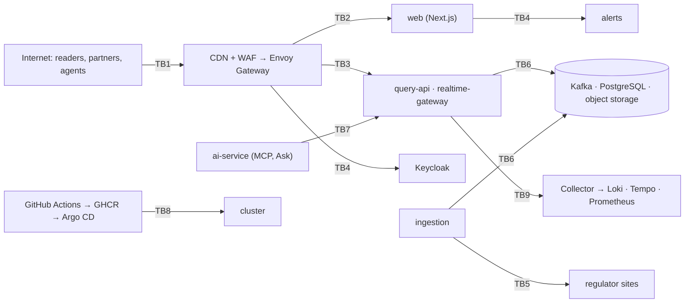

# Threat model

Status: living document, reviewed whenever a service or trust boundary is added (decision 0013).
Method: STRIDE per trust boundary. Each threat has a mitigation, its status, and an owning workstream.
Last review: 2026-10-20 (P7).

Status legend: **done** (in the code or configuration on `main` or this branch), **planned** (designed in a
decision record and assigned to a workstream), **accepted** (residual risk, with the reason).

## What we protect

| Asset | Classification | Where | Notes |
|---|---|---|---|
| Raw regulator documents (bronze) | Confidential: contain real names of natural persons | object storage, private bucket | Never published (decision 0002, docs/legal-and-ethics.md) |
| Pseudonym key | Secret | External Secrets / SOPS | Re-identification key for natural persons |
| Silver and gold data | Public (pseudonymized) | Parquet, DuckLake catalog | Integrity matters more than confidentiality |
| User accounts, watchlists, alert rules, webhook secrets | Personal data, confidential | PostgreSQL (alerts) and Keycloak | P3 |
| API keys | Secret (stored as hashes) | PostgreSQL | Partner quotas |
| Telemetry (traces, logs, metrics) | Internal; may contain IP addresses | Collector, Loki, Tempo, Prometheus | IPs are hashed in the Collector |
| CI credentials, signing identity | Secret | GitHub OIDC, cosign keyless | P6 |
| Availability of the public API and live feed | Business | Kubernetes | SLOs in decision 0014 |

## Trust boundaries

## TB1: Internet to edge (CDN, WAF, Envoy Gateway)

| STRIDE | Threat | Mitigation | Status | Owner |
|---|---|---|---|---|
| S | Forged partner identity | OAuth 2.0 client credentials (Keycloak), JWT validation at Envoy (issuer, audience, expiry) | planned | P3, P6 |
| T | Traffic tampering, downgrade | TLS 1.3 at the edge (cert-manager), HSTS with preload on web and API | done (headers), planned (TLS) | P7, P6 |
| R | Abuse without trace | Access logs at Envoy with hashed client IP and request id, propagated as W3C trace context | planned | P6, P7 |
| I | Scraping of everything | Data is public by design; bulk downloads offered (WS8) so scraping has no advantage | accepted | - |
| D | Request floods, slowloris, SSE connection exhaustion | CDN + WAF rate rules; Envoy per-client limits and request size limits; per-IP token bucket in the API (`ATLAS_RATE_LIMIT_PER_MINUTE`); HPA; SSE keep-alive and retry headers | done (API), planned (edge) | P7, P6 |
| E | Path traversal or admin endpoints reachable from the internet | Gateway routes only `/v1/*` and the website; no admin routes are exposed; Kubernetes NetworkPolicies | planned | P6 |

## TB2: Browser to website (Next.js)

| STRIDE | Threat | Mitigation | Status | Owner |
|---|---|---|---|---|
| S | Session theft | Keycloak authorization code + PKCE, passkeys; HttpOnly, Secure, SameSite cookies | planned | P3 |
| T | Cross-site scripting through filing content (issuer names come from regulators) | React escapes all text; no `dangerouslySetInnerHTML`; Content-Security-Policy with `object-src 'none'`, `base-uri 'self'`, `form-action 'self'`, `frame-ancestors 'none'` and a `connect-src` allowlist; SRI hashes on bundles | done | P7, P5 |
| T | Clickjacking | `frame-ancestors 'none'` and `X-Frame-Options: DENY` | done | P7 |
| I | Referrer leakage of query strings | `Referrer-Policy: strict-origin-when-cross-origin` | done | P7 |
| D | Cache-busting floods on dynamic pages | Cache Components serve static shells; revalidation endpoint requires a secret | done | P1 |
| E | Abuse of the revalidation route | Shared secret in `ATLAS_REVALIDATE_SECRET`, compared server-side; never exposed to the client | done | P1 |

Residual risk (accepted): `script-src` allows `'unsafe-inline'` because Next.js streams the React Server
Components payload in inline scripts that differ per render. A nonce-based policy would force dynamic rendering
of every page and defeat Cache Components (decision 0009). Revisit when Next.js supports hashes for streamed
payloads; until then, XSS defense rests on React escaping and the other directives above.

## TB3: Clients to public APIs (query-api, realtime-gateway)

| STRIDE | Threat | Mitigation | Status | Owner |
|---|---|---|---|---|
| S | Spoofed client IP to dodge rate limits | Client address taken from the ASGI scope; behind a proxy, uvicorn `--forwarded-allow-ips` lists that proxy only | done | P7 |
| T | SQL injection through filters | All filters are bound parameters; the only interpolated value (`bucket`) is validated against a literal set | done | P1 |
| T | Cursor tampering | Cursors are opaque but only encode a position; invalid cursors return 400 (RFC 9457) | done | P1 |
| R | Disputed responses | Every response carries the snapshot version (`ETag`, `X-Atlas-Snapshot`) and reproducible ids | done | P1 |
| I | Re-identification of natural persons | Only pseudonymous `person_id`s in gold; names never leave bronze; notifier names kept only for legal entities | done | M0 |
| I | MIME sniffing or embedding of JSON | `X-Content-Type-Options: nosniff`, `Content-Security-Policy: default-src 'none'` on JSON | done | P7 |
| D | Expensive queries (large limits, wide date ranges) | `limit` capped (200 / 500), pagination by cursor, p95 SLO with alerts, k6 budgets in CI | done | P1, P7 |
| D | Unbounded SSE connections | Per-IP rate limit on connects, `retry:` hint, ping every 15 s; per-client caps at Envoy | done (API), planned (edge) | P7, P6 |
| E | Write access through the read API | The API is read-only (GET only, CORS restricted to GET); DuckDB runs in memory with views over Parquet files | done | P1 |

## TB4: Signed-in users and identity (Keycloak, alerts)

| STRIDE | Threat | Mitigation | Status | Owner |
|---|---|---|---|---|
| S | Credential stuffing | Passkeys first; Keycloak brute-force detection; no password reuse across clients | planned | P3 |
| T | Insecure direct object reference on watchlists | Every alerts query scoped by the token subject; tests for cross-user access | planned | P3 |
| R | Disputed alert deliveries | Delivery log per attempt; Standard Webhooks signatures with timestamps | planned | P3 |
| I | Webhook secrets or emails leaking in logs | Structured logs with redaction; secrets hashed or encrypted at rest | planned | P3, P7 |
| D | Webhook targets that hang | Timeouts, retry topics with backoff, dead-letter topic | planned | P3 |
| E | SSRF through user-provided webhook URLs | Resolve and reject private, loopback and link-local addresses; egress NetworkPolicy | planned | P3, P6 |

## TB5: Ingestion to regulator sites (untrusted input)

| STRIDE | Threat | Mitigation | Status | Owner |
|---|---|---|---|---|
| S | DNS or TLS spoofing of a regulator | TLS verification on; allowlist of regulator hosts in `PoliteClient` | done (TLS), planned (allowlist) | M0, P2 |
| T | Malicious PDF or spreadsheet exploiting the parser | Parsers run in an unprivileged container with no secrets except storage write; pinned, audited dependencies | planned | WS1, P6 |
| T | Prompt injection inside a filing reaching the LLM fallback | JSON-schema output, per-field confidence, deterministic validation of every field, no tools given to the model | planned | WS1, P4 |
| R | Unknown provenance of a record | Bronze manifest with URL, timestamp and SHA-256 for every raw document | done | M0 |
| I | Leak of bronze (real names) | Private bucket, no public ACL, never exported; `export` publishes silver and gold only | done | M0 |
| D | Our crawler overloading a regulator (reputational and legal risk) | 1 request per second per host, robots.txt, documented terms per source | done | M0 |
| E | SSRF via redirects to internal addresses | Follow redirects only to allowlisted hosts; egress NetworkPolicy to the internet only | planned | P2, P6 |

## TB6: Services to data stores (Kafka, PostgreSQL, object storage)

| STRIDE | Threat | Mitigation | Status | Owner |
|---|---|---|---|---|
| S | A compromised pod impersonating a producer | Kafka mTLS or SCRAM users per service (Strimzi), ACLs per topic | planned | P3, P6 |
| T | Poisoned events | Schema registry with BACKWARD compatibility; consumers validate CloudEvents | planned | P3 |
| I | Credentials in manifests | External Secrets with SOPS; no secrets in Git; Kyverno policy blocks plain env secrets | planned | P6 |
| D | Consumer lag starving real time | Lag alert and KEDA autoscaling (`AtlasKafkaConsumerLagHigh`) | done (alert), planned (KEDA) | P7, P6 |
| E | Over-privileged database roles | One role per service, read-only role for query-api, CloudNativePG managed users | planned | P2, P6 |

## TB7: AI service (MCP, Ask the Atlas)

| STRIDE | Threat | Mitigation | Status | Owner |
|---|---|---|---|---|
| T | Model-written SQL that modifies or exfiltrates | sqlglot guard: single SELECT, allowlisted tables, no file or network functions, row and time limits, read-only connection | planned | P4 |
| I | Prompt injection via filing text to leak system prompts or keys | No secrets in prompts; tools are read-only; outputs shown with their SQL | planned | P4 |
| D | Cost exhaustion | Per-user quota (`ask:use` scope), token budgets, Langfuse cost tracking | planned | P4 |
| E | MCP tools beyond the user's rights | Stateless server with the caller's token; scopes checked per tool | planned | P4 |

## TB8: Supply chain (GitHub Actions, GHCR, Argo CD)

| STRIDE | Threat | Mitigation | Status | Owner |
|---|---|---|---|---|
| S | Unsigned or substituted images | cosign keyless signatures; Kyverno verifies signatures at admission | planned | P6 |
| T | Vulnerable or malicious dependencies | Pinned versions and lockfiles upgraded by the owner (no update bots, single-contributor policy); pip-audit, npm audit, govulncheck and CodeQL on every PR plus a weekly scheduled run; Trivy on images; SBOM with Syft | done (scans), planned (Trivy, SBOM) | P7, P6 |
| T | Workflow injection from PR titles or branches | Workflows avoid interpolating untrusted context into `run:`; default `permissions: contents: read` | done | P7 |
| R | Who deployed what | GitOps: every change is a commit; Argo CD history | planned | P6 |
| E | Over-privileged CI tokens | Least-privilege `permissions` per job; OIDC to registries instead of long-lived secrets | done (security workflows) | P7, P6 |

## TB9: Services to observability

| STRIDE | Threat | Mitigation | Status | Owner |
|---|---|---|---|---|
| I | Personal data in telemetry (client IPs, names in logs) | The Collector hashes `client.address` and drops authorization, cookie and API-key headers; DuckDB spans record SQL text but never parameters; natural persons exist only as pseudonyms outside bronze | done | P7 |
| T | Forged telemetry hiding an incident | OTLP receivers reachable only inside the cluster (NetworkPolicy); Grafana behind Keycloak SSO | planned | P6 |
| D | Telemetry overload | Collector memory limiter, batching and tail sampling (errors, slow traces, 10% baseline) | done | P7 |
| E | Grafana admin exposure | Anonymous admin only in the local Compose stack; SSO with roles in clusters | done (local), planned (cluster) | P7, P6 |

## Verification

| Control | Where |
|---|---|
| CodeQL (Python, JavaScript/TypeScript, Go) | `.github/workflows/security.yml` |
| pip-audit, npm audit, govulncheck | `.github/workflows/security.yml` |
| OWASP ZAP baseline against the Compose-started API | `.github/workflows/security.yml` (`zap-baseline`) |
| Security headers and rate limiting | `tests/test_api_hardening.py` |
| Dependency advisories between changes | weekly scheduled run of `.github/workflows/security.yml` |
| Load and latency budgets | `loadtests/`, `.github/workflows/loadtest.yml` |
