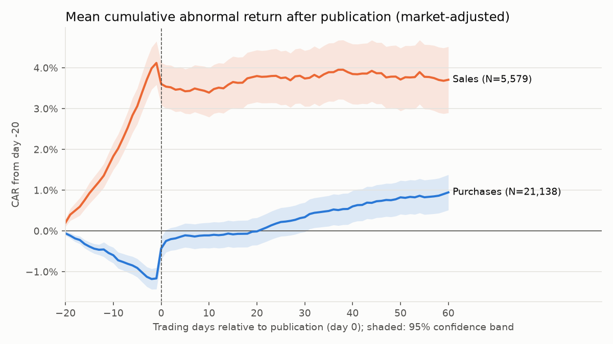
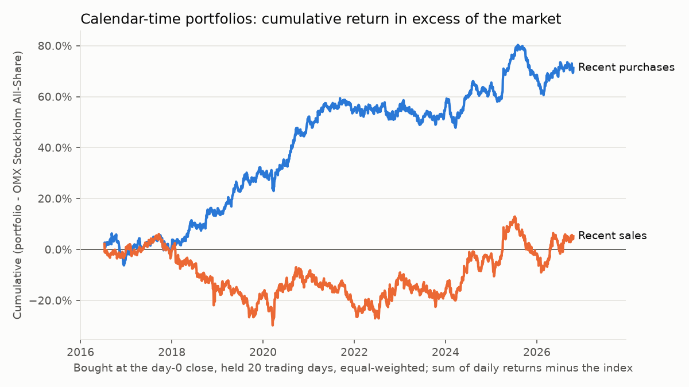

# Do European insiders beat the market? Evidence from ten years of Swedish PDMR filings

*EU Disclosure Atlas, workstream WS6. Sample: every managers' transaction published by Finansinspektionen
(FI) from 3 July 2016 to 20 October 2026. Research, not investment advice (see the end of this page).*

## Summary

- **Purchases carry information, and some of it remains after publication.** Stocks rise about 0.7% on the
  first session after a purchase is published. The cumulative abnormal return (CAR) over [0,+60] trading
  days is **+1.0% to +2.2%**, depending on the model (BMP t = 7.1 and 11.0; about 21,450 events). An outsider
  who buys at the close of day 0 and holds for 20 trading days earns a calendar-time alpha of **+3.7 bp per
  day** (about +10% a year before trading costs, Newey-West t = 3.2). The alpha survives a control for the
  small-cap, equal-weight tilt of the portfolio.
- **Sales carry much less.** They meet a short negative reaction (−0.5% on day 0, −0.7% over [0,+5],
  market-adjusted) and then nothing: market-adjusted CARs after day 0 are not significant, and calendar-time
  portfolios of recent sales earn no alpha. The large negative 60-day market-model CAR of sales (−6.4%) is an
  artefact: insiders sell after run-ups, and the market model projects that run-up's alpha into the event
  window.
- **Insiders are contrarian.** Purchases follow declines (−1.1% over the 20 sessions before publication) and
  sales follow rallies (+4.1%).
- **Strongest purchase signals:** CEOs and CFOs, and the smallest third of firms. Cluster purchases (two or
  more insiders of one issuer within five trading days) are not more informative than single purchases in
  this sample, though they follow deeper falls.

This matches the asymmetry that Lakonishok and Lee (2001) found in US data: purchases predict returns, sales
barely do. Sales are often driven by liquidity and diversification needs.

## 1. Question

Managers and board members ("persons discharging managerial responsibilities", PDMRs) must report their
transactions in their issuer's shares under Article 19 of the Market Abuse Regulation (EU) No 596/2014, and
the competent authority publishes them. Two questions follow:

1. Do these trades predict abnormal returns?
2. Can an outsider capture that predictability after publication?

For the second, the clock starts at **publication**, not at the trade, because publication is the moment
outsiders can act.

## 2. Data

| Item | Value |
|---|---:|
| FI register records ingested (July 2016 to October 2026) | 169,020 |
| Open-market share purchases and sales (transaction lines) | 88,086 |
| Events (issuer × direction × publication day) | 44,099 |
| ISINs / mapped to a Yahoo Finance ticker | 2,540 / 923 |
| Events with a usable [0,+20] CAR | **27,090 (61.4%)** |
| of which purchases / sales | 21,463 / 5,627 |
| Distinct stocks in the usable sample | 736 |

- **Source.** The FI PDMR register ([source note](../../docs/sources/se_fi_pdmr.md)), ingested with the
  project's `se_fi_pdmr` connector into the local lake in 545 weekly windows. No window reached the export's
  1,000-row cap, so no data was truncated.
- **Selection.** Purchases and sales of shares on a trading venue: the gold `is_open_market` flag.
- **Untyped instruments.** FI's exports leave the instrument type empty for publications before about
  mid-2018, so gold cannot tell shares from warrants for those years. The study keeps on-venue buys and
  sales with an empty type only if two checks hold:
  - the ISIN resolves to a Stockholm equity listing (warrants, BTAs and rights do not);
  - the filing price matches the market price.

  This rule kept 3,489 of 7,285 such events.
- **Events.** All lines of one issuer and direction published on the same day form one event, carrying:
  - the total amount in euros (ECB reference rates);
  - the most senior role involved;
  - the number of distinct insiders.

  One observation per stock and day keeps the cross-section closer to independent.
- **Prices.** Daily split- and dividend-adjusted closes from Yahoo Finance (yfinance). The benchmark is the
  OMX Stockholm All-Share index (`^OMXSPI`).
- **Ticker mapping.** ISINs map to tickers by Yahoo search, then OpenFIGI. The mapping is cached in
  [`data/isin_tickers.csv`](data/isin_tickers.csv) and holds identifiers only.
- **Price check.** For each ISIN, filing prices in SEK are compared with the market close on the trade
  date. An ISIN is dropped when its price ratio is neither close to 1 nor stable (a stable ratio means a
  constant adjustment, such as a rights issue). This dropped 30 ISINs, or 678 events.

Coverage is uneven, and the gaps are not random (section 6):

| Market segment | Events | Mapped to prices | Usable [0,+20] |
|---|---:|---:|---:|
| Nasdaq Stockholm | 24,619 | 18,362 | 17,684 (72%) |
| First North | 10,503 | 6,699 | 6,034 (57%) |
| Spotlight | 4,105 | 2,337 | 2,003 (49%) |
| NGM | 1,581 | 83 | 7 (0%) |
| Other venues | 3,291 | 1,432 | 1,362 (41%) |

Coverage rises from 39% of events in 2016 to 80% in 2025 ([by year](results/coverage_by_year.csv)). Of the
events without prices, 9,787 are in shares that OpenFIGI knows but Yahoo no longer lists, mostly delisted
firms. Another 4,130 have an ISIN that OpenFIGI does not know either, such as temporary BTA lines. The rest
are other instruments.

## 3. Method

- **Day 0** is the first session in which an outsider could trade after publication:
  - the publication day, if the filing appeared before 17:25 Stockholm time (the end of continuous trading
    before the closing auction);
  - otherwise the next trading day.

  Weekends and holidays roll forward to the next session.
- **Abnormal returns**, two specifications:
  - the *market model*, estimated by OLS on days [−250, −30] with at least 120 returns;
  - *market-adjusted* returns (stock minus index: alpha 0, beta 1).

  The second guards against a known bias: a stock that rallied during the estimation window gets a high
  alpha, and the market model then expects the rally to continue.
- **Thin trading.** Returns come from forward-filled prices (at most 10 stale days), so a multi-day move is
  booked when the stock trades again. A window is dropped if the stock has no price at its end (delisting or
  end of data), or if fewer than 80% of its days have returns.
- **Windows.**
  - [0,+5], [0,+20] and [0,+60] are the required horizons.
  - [0,0] isolates the publication reaction.
  - [+1,+20] starts at the day-0 close: the part an outsider can capture even with a publication during the
    session.
  - [−20,−1] measures the run-up.
- **Tests.**
  - The cross-sectional t-statistic.
  - The standardized cross-sectional test of Boehmer, Musumeci and Poulsen (1991, *JFE*), "BMP", which is
    robust to event-induced volatility. It is the t reported in the tables. Because it weights CARs by the
    inverse of each stock's volatility, its sign can differ from that of a small raw mean.
  - Benjamini-Hochberg q-values over every subgroup test of the same model and window. In the tables,
    **bold** means q < 0.05.
- **Splits.**
  - Role: CEO/CFO, chair/board, other.
  - Trade size in euros: < 25k, 25k-100k, 100k-1m, ≥ 1m.
  - Cluster: at least two distinct insiders of the issuer trading in the same direction within the trailing
    five trading days, day 0 included, so only information public at day 0 is used.
  - Firm size: terciles by year of the median daily traded value over the estimation window, a size and
    liquidity proxy known at day 0 (market capitalisation history is not available for free).
  - Period: 2016-2019, 2020 to November 2024, and from 4 December 2024, when Sweden's notification threshold
    rose to EUR 20,000 a year under the Listing Act
    ([source note](../../docs/sources/se_fi_pdmr.md)).
  - Publication time.
- **Calendar-time portfolios**, as a robustness check against cross-correlation from overlapping events
  (Fama, 1998; Jeng, Metrick and Zeckhauser, 2003, *REStat*):
  - each day, an equal-weighted portfolio of the stocks with an event in the last 20 or 60 sessions;
  - entry on day 0 or on day +1;
  - regressed on the index alone, then on the index plus an equal-weighted universe of all sample stocks
    with prices (a control for the small-cap tilt);
  - Newey-West standard errors with 5 lags.

## 4. Results

### Headline

All events, BMP t-statistics in parentheses; full tables in [results/tables.md](results/tables.md) and
[results/car_by_group.csv](results/car_by_group.csv).

| | Model | CAR [−20,−1] | [0,0] | [0,+5] | [0,+20] | [0,+60] | [+1,+20] |
|---|---|---:|---:|---:|---:|---:|---:|
| Purchases (21,449) | market model | **−1.71%** (−19.4) | **+0.70%** (19.0) | **+0.85%** (13.3) | **+0.62%** (5.9) | **+1.02%** (7.1) | −0.07% (−0.2) |
| | market-adjusted | **−1.13%** (−16.5) | **+0.74%** (20.5) | **+1.06%** (16.9) | **+1.13%** (9.6) | **+2.15%** (11.0) | **+0.39%** (2.8) |
| Sales (5,626) | market model | **+2.17%** (10.0) | **−0.62%** (−12.3) | **−1.30%** (−12.8) | **−2.42%** (−13.0) | **−6.40%** (−16.4) | **−1.80%** (−10.2) |
| | market-adjusted | **+4.12%** (18.5) | **−0.52%** (−10.2) | **−0.69%** (−6.8) | −0.32% (−1.7) | −0.40% (0.3) | +0.20% (1.1) |



The market-model version of the same figure ([car_buys_sells.png](figures/car_buys_sells.png)) shows sales
drifting down for 60 days. Market-adjusted, they do not. The two specifications differ only in the
extrapolated alpha, and sales follow a strong pre-event run-up, so the market-adjusted path and the
calendar-time results below are the more credible reading for sales. For purchases, both specifications
agree on the sign of every window except the small [+1,+20] drift.

### Who trades, and does it matter?

Purchases, [0,+20] CAR (BMP t):

| Split | Group | N | Market model | Market-adjusted |
|---|---|---:|---:|---:|
| Role | CEO/CFO | 7,037 | **+1.02%** (4.6) | **+1.46%** (6.5) |
| | Chair/board | 9,627 | **+0.58%** (5.3) | **+1.25%** (7.4) |
| | Other | 4,785 | +0.12% (−0.5) | +0.39% (1.9) |
| Firm size | Small | 7,515 | **+1.15%** (6.8) | **+2.00%** (7.0) |
| | Mid | 7,096 | +0.32% (1.8) | **+0.83%** (4.8) |
| | Large | 6,838 | +0.37% (1.9) | **+0.47%** (4.8) |
| Cluster | Single insider | 14,821 | **+0.60%** (5.8) | **+1.18%** (8.9) |
| | ≥ 2 insiders in 5 days | 6,628 | **+0.67%** (2.0) | **+1.02%** (4.0) |
| Trade size | < EUR 25k | 12,676 | **+0.60%** (4.5) | **+1.17%** (6.0) |
| | EUR 25k-100k | 5,190 | **+0.66%** (2.9) | **+1.11%** (5.5) |
| | EUR 100k-1m | 2,514 | +0.67% (1.6) | **+1.17%** (4.5) |
| | ≥ EUR 1m | 1,019 | **+0.74%** (2.3) | **+0.72%** (2.6) |
| Period | 2016-2019 | 3,956 | **+0.29%** (3.3) | **+1.27%** (6.9) |
| | 2020 to Nov 2024 | 11,913 | **+0.64%** (2.6) | **+0.95%** (4.5) |
| | Dec 2024 to 2026 | 5,580 | **+0.83%** (5.6) | **+1.40%** (6.8) |

- **Role.** Executives' purchases are the most informative, in line with the information-hierarchy
  results of Seyhun (1986). Purchases by "other" PDMRs are not significant after day 0.
- **Firm size.** The effect concentrates in small firms, where information asymmetry is largest and
  attention lowest. The same firms are also the most expensive to trade.
- **Clusters and trade size.** Neither shows a gradient. Cluster purchases come after a −3.0% run-down
  (market model) and recover in line with single purchases
  ([figure](figures/car_cluster_buys.png)). Larger trades react more on day 0 but not over 20 days.
- **Period.** The effect is present in all three periods, including after the Listing Act threshold rose to
  EUR 20,000 in December 2024.
- **Publication time.** Filings published after the close, whose day 0 is the next session, still move
  prices by +0.90% on day 0 (market model). So the day-0 reaction is a reaction to publication, not to
  intraday moves before it ([tables](results/tables.md)).

### Calendar-time portfolios

Equal-weighted, rebalanced daily, 2,577 trading days ([results/calendar_time.csv](results/calendar_time.csv)):

| Portfolio | Entry | Hold | Avg. stocks | Alpha/day vs index | t (NW) | Alpha/day vs index + EW universe | t (NW) |
|---|---:|---:|---:|---:|---:|---:|---:|
| Purchases | day 0 | 20 | 97 | +6.5 bp | 5.37 | +6.1 bp | 5.08 |
| Purchases | day +1 | 20 | 97 | **+3.7 bp** | 3.17 | +3.3 bp | 2.86 |
| Purchases | day +1 | 60 | 208 | +3.9 bp | 3.62 | +3.5 bp | 3.31 |
| Sales | day +1 | 20 | 30 | +1.0 bp | 0.69 | +0.5 bp | 0.38 |
| Sales | day +1 | 60 | 73 | +0.4 bp | 0.38 | −0.0 bp | −0.02 |
| Purchases − sales | day +1 | 60 | 281 | +3.5 bp | 4.67 | +3.5 bp | 4.69 |



Entering at the day-0 close cuts the purchase alpha roughly in half, from 6.5 to 3.7 bp a day. The other
half is the publication-day reaction, which only a reader who acts within minutes of publication captures.

For costs, the 20-day portfolio's 3.7 bp a day is about **0.74% per round trip**. That is the break-even
trading cost, and it is of the order of the bid-ask spread of many First North and Spotlight stocks, which
dominate the small-firm tercile. Also, 51 of the 71 percentage points of cumulative excess return accrued
from 2018 to 2020. The
evidence that insider purchases are informative is strong; the evidence that copying them is profitable
after costs is weak.

## 5. Related literature

- **Seyhun (1986, *Journal of Financial Economics*).** In US data, insiders earn abnormal returns, and those
  closer to the firm's information (top executives) earn more. Outsiders who imitate them gain little after
  costs. Our role gradient and our cost caveat point the same way.
- **Lakonishok and Lee (2001, *Review of Financial Studies*).** Insider purchases predict returns, mainly
  in small firms; sales do not, beyond a modest announcement reaction. Both the asymmetry and the
  concentration in small firms appear here.
- **Fidrmuc, Goergen and Renneboog (2006, *Journal of Finance*).** In the UK, directors' purchases trigger
  positive and sales negative announcement reactions that depend on firm characteristics and news. Our
  day-0 reactions are the Swedish counterpart.
- **Betzer and Theissen (2009, *European Financial Management*).** Significant abnormal returns around
  German directors' dealings, related to corporate-governance characteristics. They are the closest
  Continental European benchmark.
- **Cohen, Malloy and Pomorski (2012, *Journal of Finance*).** Separating *routine* insiders (who trade in
  the same month every year) from *opportunistic* ones isolates the informative trades. This study does not
  yet make that split; it is the natural next step.
- **Jeng, Metrick and Zeckhauser (2003, *Review of Economics and Statistics*).** Calendar-time portfolios
  show abnormal returns for insider purchases but not for sales. This is the design of our robustness
  check, with the same answer.
- **Method.** Boehmer, Musumeci and Poulsen (1991, *JFE*) for the standardized test; Fama (1998, *JFE*) on
  long-horizon event studies and calendar-time portfolios;
  Benjamini and Hochberg (1995, *JRSS B*) for false-discovery-rate control; Newey and West (1987,
  *Econometrica*) for autocorrelation-robust errors.

## 6. Limitations

- **Survivorship and delisted firms.** Yahoo Finance keeps no history for most delisted stocks: 9,787
  events in ordinary shares have no prices, and the gap is largest in early years (39% coverage in 2016)
  and on NGM and Spotlight. Firms that delisted after poor performance, or after a takeover, are therefore
  missing. The bias is likely upward for purchases. Excluding takeover targets cuts the other way.
- **Benchmark.** `^OMXSPI` is a price index, while stock returns include dividends. This biases
  market-adjusted CARs upward by roughly the stock's dividend yield: about 0.25% over 20 days and 0.7% over
  60 days at a 3% yield, which is less for the low-yield small caps that dominate the sample. The market model
  is immune, because its alpha absorbs the yield. So is the second calendar-time specification, whose
  equal-weighted universe also includes dividends. Read the purchase CARs as lying between the two models.
  No Swedish size or value factors are used beyond the equal-weighted universe control, and there is no
  risk-free rate.
- **Thin trading.** Many First North and Spotlight shares trade rarely. Stale prices bias betas toward zero
  and push returns to later days. Forward-filling books the move when trading resumes, but the
  market-model estimates for these stocks are noisy.
- **Overlapping windows.** Events of the same stock or date overlap, especially over 60 days, so
  cross-sectional t-statistics overstate precision. The calendar-time portfolios and the standardized test
  are the main defences. Their t-statistics are smaller and are the ones to trust.
- **Multiple testing.** The tables hold 480 subgroup tests (2 models × 2 directions × 20 groups × 6
  windows). Benjamini-Hochberg q-values are computed per model and window. The splits were chosen in
  advance (ROADMAP WS6) and not mined, but individual subgroup differences should still be read as
  suggestive. The headline full-sample results have t-statistics far beyond any correction.
- **Publication time and day 0.** FI timestamps record when the register published the filing. Issuers often
  publish a press release first, sometimes minutes or hours earlier, so day 0 may lag the first public
  information.
- **Data quirks.**
  - The empty instrument type before 2018 (section 2).
  - Prices in other currencies for dual-listed issuers, which skip the price check.
  - Yahoo's adjusted closes are also adjusted for rights issues.
  - Revisions at FI are handled by the lake (latest version, superseded rows excluded).
- **Scope.** Sweden only. "European insiders" in the title is the project's question; other countries
  follow as their connectors land (WS1 to WS3).

## 7. Reproduce

From a clean clone, at the repository root:

```bash
python3.12 -m venv .venv && source .venv/bin/activate && pip install -e '.[dev,research]'
python research/insider_event_study/run.py --backfill --until 2026-10-20
```

- **Steps.** `--backfill` ingests the FI register year by year into `./lake`
  ([backfill.sh](backfill.sh), resumable; one to two hours the first time at FI's response times). The
  script then loads ECB rates, maps tickers, downloads prices and writes `results/` and `figures/`.
- **Pinned and moving inputs.**
  - `--until 2026-10-20` pins the sample to the one reported here.
  - The ticker mapping is committed.
  - Prices are downloaded fresh, so small differences can appear if Yahoo revises its adjusted history.
- **Tests.** `pytest research/insider_event_study/tests` runs the study's offline tests on synthetic data.
- **What is committed.** Only code, aggregated tables and figures. The lake, raw files, prices and
  event-level data (which carry pseudonymous insider ids) stay local in `lake/` and `cache/`.

FI open data may be re-used with attribution: Source: Finansinspektionen (FI), PDMR transactions register,
retrieved 20 October 2026.

## Not investment advice

This is academic-style research on public data. It describes average historical patterns with known
biases; it is not a recommendation to buy or sell any security, and nothing here should be used to place
orders. Past patterns, especially before trading costs, do not predict future returns.
