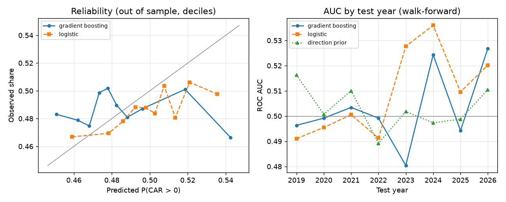

# Model card: `insider-signal`

*EU Disclosure Atlas, workstream P8. Format after Mitchell et al. (2019), "Model Cards for Model Reporting".
Research output, never investment advice.*

## In one paragraph

`insider-signal` estimates, for each open-market insider purchase or sale of shares, the probability that the
share beats the market over the 20 trading sessions after the filing became public. On ten years of Swedish
filings, validated walk-forward with no look-ahead, **it does not beat a constant base rate**. Out-of-sample AUC
is 0.500 (95% interval 0.486 to 0.514), and the Brier skill score against the base rate is −0.3%. The
logistic-regression baseline does no better: AUC 0.512, with an interval that includes 0.5. The model ships
because the pipeline around it is the deliverable: features from gold, walk-forward validation, MLflow registry,
batch scoring, drift monitoring and this card. Read every score it produces as "about 46%, like everything else".

## Model details

| Item | Value |
|---|---|
| Name and registry | `insider-signal` in MLflow, alias `champion` (see `src/disclosure_atlas/ml/registry.py`) |
| Type | Histogram gradient boosting (scikit-learn), Platt (sigmoid) calibration on the most recent 20% of the training rows |
| Hyperparameters | learning rate 0.04, 250 iterations, 15 leaves, at least 200 events per leaf, L2 1.0, fixed seed |
| Serialization | skops (MLflow 3 default for scikit-learn); trusted types listed in `ml/model.py` |
| Training data | 27,090 Swedish events published 8 July 2016 to 22 September 2026 (the last outcomes known on 20 October 2026) |
| Code | `src/disclosure_atlas/ml/` (features, labels, model, validation, drift, scoring); `research/signals/train.py` |
| Owner | EU Disclosure Atlas (Manuel David Maya Rosero), October 2026 |

## Intended use

- **Intended:** a worked, reproducible example of MLOps on public disclosure data. It is also a research baseline
  for asking whether filing characteristics predict post-publication returns, and the source of
  `GET /v1/signals`, which always returns the disclaimer and the metrics.
- **Out of scope:** trading, investment advice, ranking people, any judgement about an individual insider, and
  any market other than Sweden until it has been validated there. The model has no information about any person:
  insiders appear only as counts and roles.

## Task and label

- **Unit:** one *event*: one share (ISIN), one direction (buy or sell) and one publication day in the authority's
  time zone. This follows the WS6 event study ([research/insider_event_study](../insider_event_study/README.md)).
- **Label:** 1 if the market-adjusted cumulative abnormal return over sessions [+1, +20] is positive, else 0.
  - The return comes from WS6, against the OMX Stockholm All-Share index.
  - Day 0 is the first session in which an outsider could trade after publication.
  - The window starts at the day-0 close, so it measures what is still available after reading the filing.
  - The base rate is 48.9%: 49.1% for buys and 48.2% for sales.

  The mean CAR of buys is positive (WS6), yet fewer than half are positive. The distribution is right-skewed: a
  few large winners lift the mean while the median event loses slightly. This matters for the results below.

## Features

Every feature is known at publication: filings already public, and prices of sessions strictly before the
publication day (`ml/features.py`).

| Feature | Definition |
|---|---|
| `is_buy` | 1 for purchases, 0 for sales |
| `role_seniority` | Most senior insider in the event: 0 CEO, 1 CFO, 2 chair, 3 executive, 4 board member, 5 other |
| `log_amount_eur` | log10(1 + total amount in euros, ECB reference rates) |
| `n_insiders` | Distinct insiders in the event |
| `cluster_insiders_30d` | Distinct insiders of the issuer trading in the same direction over the last 30 days, the day included |
| `filing_lag_days` | Days from the latest trade to publication |
| `log_traded_value_60d` | log10 of the median daily close × volume over the last 60 sessions: a size and liquidity proxy |
| `momentum_20d` | Share return over the last 20 sessions (unadjusted closes, as the price cache serves them) |

Training and scoring share one implementation, so the features cannot drift apart in code:
- **Training:** price features come from the WS6 Yahoo Finance cache.
- **Scoring:** they come from the lake's price cache. A share with no cached prices gets missing values, which the
  model handles natively.

## Validation: walk-forward, no look-ahead

- **Folds:** expanding window, one test year per fold, 2019 to 2026, so there are 8 folds and 23,387
  out-of-sample events.
- **No look-ahead:** each fold trains only on events whose outcome was known before 1 January of the test year.
  An event counts as known 35 calendar days after publication, which is longer than day 0 plus 20 sessions plus
  holidays. Calibration uses the newest training rows, later in time than the trees' rows.
- **Baselines** (same folds):
  - `prior`: the training base rate;
  - `direction_prior`: the base rate of buys and of sales;
  - `logistic`: a regularized logistic regression on the same features, with median imputation and missing
    indicators.
- **AUC interval:** a 95% interval from 1,000 bootstrap resamples by publication month. Events of one month share
  market conditions, so resampling single events would give too narrow an interval.

### Pooled out-of-sample results

| Candidate | AUC [95% interval] | AUC buys | AUC sells | Brier | Brier skill | ECE | Top-decile hit rate | Top-decile mean CAR |
|---|---:|---:|---:|---:|---:|---:|---:|---:|
| prior | 0.507 [0.483, 0.530] | 0.508 | 0.505 | 0.2499 | 0 | 0.021 | 48.6% | +0.36% |
| direction_prior | 0.507 [0.490, 0.523] | 0.510 | 0.473 | 0.2500 | −0.0003 | 0.024 | 48.7% | +0.37% |
| logistic | 0.512 [0.496, 0.526] | 0.512 | 0.510 | 0.2501 | −0.0006 | 0.015 | 52.2% | +0.13% |
| **gradient_boosting** | **0.500 [0.486, 0.514]** | 0.501 | 0.495 | 0.2506 | −0.0029 | 0.022 | 50.2% | +0.01% |

- The mean CAR of all test events is +0.36%.
- The `prior` AUC is above 0.5 only because base rates differ between test years; within a year it is 0.5 by
  construction.
- Top-decile figures take the 10% best-scored events of each test year.
- Sources: [walk_forward_pooled.csv](results/walk_forward_pooled.csv) and
  [walk_forward_by_year.csv](results/walk_forward_by_year.csv).

### By test year (gradient boosting)

| Test year | Events | Base rate | AUC | AUC logistic | Brier skill | ECE | Top-decile mean CAR | Mean CAR |
|---|---:|---:|---:|---:|---:|---:|---:|---:|
| 2019 | 1,867 | 0.512 | 0.496 | 0.491 | −0.0026 | 0.039 | +1.93% | +0.89% |
| 2020 | 2,444 | 0.519 | 0.499 | 0.495 | −0.0036 | 0.031 | −0.19% | +0.90% |
| 2021 | 2,562 | 0.463 | 0.503 | 0.501 | −0.0153 | 0.078 | +0.01% | −0.08% |
| 2022 | 3,260 | 0.488 | 0.499 | 0.491 | −0.0025 | 0.032 | −1.00% | −0.20% |
| 2023 | 3,395 | 0.480 | 0.480 | 0.528 | −0.0009 | 0.029 | −0.58% | +0.04% |
| 2024 | 3,453 | 0.483 | 0.524 | 0.536 | +0.0027 | 0.022 | +1.90% | +0.32% |
| 2025 | 3,641 | 0.480 | 0.494 | 0.510 | −0.0047 | 0.034 | −1.06% | +0.46% |
| 2026 | 2,765 | 0.478 | 0.527 | 0.520 | +0.0016 | 0.022 | −0.14% | +0.87% |



### Reading the results

- **No skill.** No candidate separates winners from losers out of sample, and every interval includes 0.5. The
  gradient-boosting model is slightly *worse* calibrated than the base rate: the trees fit noise, and the
  calibration only shrinks it.
  - In the reliability diagram, the decile the model likes most (predicted 54%) was positive 46.6% of the time,
    below the base rate.
  - The logistic regression is the best candidate on every metric except the Brier score. Its edge (AUC +0.012)
    sits inside the noise. It is positive in 2023 to 2026, but four years is too short to call that a trend.
- **Consistent with WS6, not a contradiction.** WS6 finds that purchases are followed by positive mean abnormal
  returns (about +1% to +2% over [0,+60]). That is an average driven by a right tail. This model asks a different
  question: *which* trades will beat the market? Sign prediction discards the size of the move, and the median
  event loses slightly. A model can fail to rank events even when their average is informative.
- **What the model uses.** Permutation importance on the 2026 fold ([permutation_importance.csv](results/permutation_importance.csv))
  ranks size (traded value), momentum and cluster count first. These variables carry the strongest subgroup
  effects in WS6, the small-firm and contrarian patterns. Their importance in a fold with an AUC of 0.53 shows
  what the model reacts to, not that the reaction pays.
- **Selection.** The hyperparameters were set before the first walk-forward run. After seeing the results, two
  smaller tree configurations were tried, a stump ensemble and 7-leaf trees. Neither did better (pooled AUC 0.501
  and 0.497), and the original was kept. No other configuration was tried, so the table above is not the best of
  many draws.

## Monitoring

- **Drift:** population stability index (PSI) of every feature against its training deciles (`ml/drift.py`).
  The thresholds follow the usual convention: 0.1 means a moderate shift, 0.25 a significant one.
- **Missing values** are reported apart, next to their training share. Training events all have prices because
  labels need them, but a newly scored share is often not in the price cache yet. Folding that gap into the PSI
  would flag every batch.
- **Where it runs:** the Dagster check `ml/insider_signals:feature_drift` warns on any significant shift, and
  `GET /v1/signals` returns the full drift report.
- **Last fold against history:** 2026 events against 2016 to 2025, all features stable (largest PSI 0.06, for
  `is_buy`).
- **First scoring batch:** the 4,524 events published from 20 October 2025 to 20 October 2026 are stable (largest
  PSI 0.06, for `role_seniority`). 15% of them lack price features.
- **Retraining** is a deliberate step: run `research/signals/train.py`, review the card, and the champion alias
  moves. Scoring never retrains.

## Limitations and risks

- **One market.** Sweden only (FI register). Other markets have other filing rules, costs and insider mixes;
  scores on other countries' events are extrapolation until they are validated there.
- **Survivorship and coverage.** Labels exist only for events whose share has prices: 61% of WS6 events, fewer for
  small venues and for delisted firms. The sample leans towards larger, surviving firms (WS6, section 6).
- **Pre-2018 instrument typing.** FI's older exports leave the instrument type empty. WS6 infers shares from the
  ticker mapping and a price check, which can admit some mistyped lines.
- **Benchmark and costs.** Labels are relative to a value-weighted index, with no trading costs, spreads or
  market impact. Small, illiquid shares dominate the positive tail and are the most expensive to trade.
- **Unadjusted momentum.** Momentum uses unadjusted closes (the serving cache has nothing else), so a split
  inside the window distorts it. Trees are robust to a few outliers, not to systematic ones.
- **Weak label.** The sign of a 20-session return is mostly noise. Better targets for future work:
  - the CAR itself (regression);
  - the top quintile of CARs;
  - a longer horizon with a volatility-scaled return.

  Each must be pre-registered in [docs/research-agenda.md](../../docs/research-agenda.md) before it is run.
- **Misuse.** Scores could be misread as recommendations or as statements about people. The API attaches the
  disclaimer and the out-of-sample metrics to every response. The model never sees insider identities, and its
  outputs carry no person identifiers. Not investment advice.

## Reproduce

```bash
pip install -e '.[ml,research]'
python research/insider_event_study/run.py --backfill --until 2026-10-20   # WS6: lake, prices, outcomes
python research/signals/train.py --lake lake                               # walk-forward, MLflow, registry
disclosure-atlas --lake lake signals score                                 # or the Dagster asset ml/insider_signals
```

## References

- Lakonishok, J. and Lee, I. (2001). Are insider trades informative? *Review of Financial Studies* 14(1), 79-111.
- Mitchell, M. et al. (2019). Model Cards for Model Reporting. *FAT\* '19*, 220-229.
- Siddiqi, N. (2006). *Credit Risk Scorecards*. Wiley. The PSI and its 0.1 and 0.25 conventions.
- Regulation (EU) No 596/2014 (Market Abuse Regulation), Article 19:
  [EUR-Lex](https://eur-lex.europa.eu/eli/reg/2014/596/oj).
