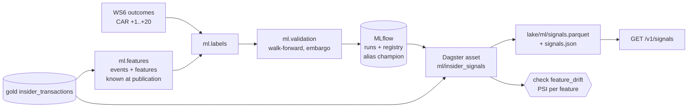

# Insider signals: an MLOps pipeline on PDMR filings (P8)

*EU Disclosure Atlas, workstream P8 ([decision 0014](../../docs/decisions/0014-observability-slos-and-mlops.md)).
Research output, never investment advice.*

**Result first:** on 27,090 Swedish insider-trade events from 2016 to 2026, a calibrated gradient-boosting
classifier has no skill out of sample at predicting which trades beat the market over the next 20 sessions. Its
walk-forward AUC is 0.500 (95% interval 0.486 to 0.514), and it does not beat the base rate on the Brier score.
The logistic baseline reaches AUC 0.512, inside the noise. The [model card](MODEL_CARD.md) has the full results,
the limitations, and why this does not contradict the positive mean returns after purchases found in
[WS6](../insider_event_study/README.md).

What this workstream delivers is the pipeline, built so that a better model or label can replace this one
without changing anything around it:



## Components

| Piece | Where | Notes |
|---|---|---|
| Events and features | `src/disclosure_atlas/ml/features.py` | One code path for training and scoring; prices strictly before publication |
| Labels | `ml/labels.py` | WS6 market-adjusted CAR [+1,+20] > 0; known 35 days after publication |
| Model and baselines | `ml/model.py` | Gradient boosting + sigmoid calibration on the newest 20%; prior, direction prior, logistic |
| Walk-forward | `ml/validation.py` | Yearly expanding folds 2019-2026; trains only on outcomes known before the fold |
| Drift | `ml/drift.py` | PSI against training deciles; missing values reported apart |
| Tracking and registry | `ml/registry.py` | MLflow; `insider-signal@champion` |
| Batch scoring | `ml/scoring.py`, Dagster `ml/insider_signals` (daily 07:15 Paris) | Last 365 days of events |
| API | `GET /v1/signals` (`api/signals.py`) | Scores, model metrics, drift and the disclaimer; filters `country`, `isin`, `nature`, `since`, `min_score` |
| Training run | `research/signals/train.py` | Writes `results/`, `figures/`; event-level predictions stay in `cache/` |

## MLflow store

There is no server to run:

- `lake/ml/mlflow.db`, a SQLite file, holds the runs, metrics, model versions and aliases;
- `lake/ml/artifacts/` holds the model (skops), its feature profile and the run summary.

MLflow 3 keeps its plain-folder store (`./mlruns`) in maintenance mode and refuses it unless
`MLFLOW_ALLOW_FILE_STORE=true`, so this layout is MLflow's own recommended local backend. To browse it, run
`pip install mlflow` (the full package, which has the UI) and then
`mlflow ui --backend-store-uri sqlite:///lake/ml/mlflow.db`. Set `ATLAS_MLFLOW_TRACKING_URI` to use a shared
tracking server instead.

Every training run logs:
- its parameters;
- pooled and per-fold metrics for the model and for each baseline (per-fold metrics use the test year as the step);
- the reliability figure;
- the model, registered as a new version of `insider-signal`.

Training then moves the `champion` alias to that version, and scoring loads `models:/insider-signal@champion`.

## Run it

```bash
pip install -e '.[ml,research,orchestration]'
python research/insider_event_study/run.py --backfill --until 2026-10-20   # WS6 first: lake, prices, outcomes
python research/signals/train.py --lake lake                               # ~30 s: walk-forward, MLflow, registry
disclosure-atlas --lake lake signals score                                 # batch scoring (also the Dagster asset)
disclosure-atlas --lake lake serve --port 8000                             # then GET /v1/signals
```

- **Scoring and the network:** scoring reads prices only from the lake's price cache
  (`lake/reference/prices/<provider>/`) and never calls a provider. A share that nobody has viewed yet has
  missing price features. The model handles that, and the drift report shows the missing share.
- **Training data:** training needs WS6's local cache (`research/insider_event_study/cache/`: event outcomes and
  Yahoo prices). It is git-ignored, because the event table carries pseudonymous insider ids and Yahoo's terms do
  not allow redistributing its prices.
- **Committed files:** only aggregated metrics and figures.

## Results

| File | Content |
|---|---|
| [results/walk_forward_pooled.csv](results/walk_forward_pooled.csv) | Pooled out-of-sample metrics per candidate, with bootstrap AUC intervals |
| [results/walk_forward_by_year.csv](results/walk_forward_by_year.csv) | The same per test year |
| [results/calibration.csv](results/calibration.csv) | Reliability table of the model (deciles of scores) |
| [results/permutation_importance.csv](results/permutation_importance.csv) | AUC drop per permuted feature, last fold |
| [results/dataset.json](results/dataset.json) | Sample size, coverage, missing shares, drift of the last fold against history |
| [figures/walk_forward.png](figures/walk_forward.png) | Reliability diagram and AUC by test year |

*Not investment advice. Scores describe statistical patterns in public filings; they say nothing about any
person and must not be used to trade.*
