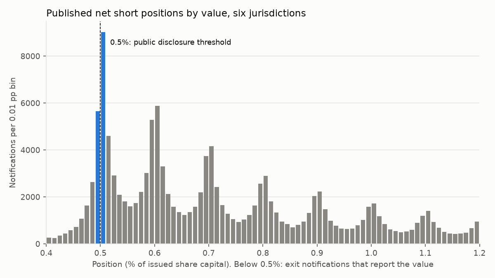
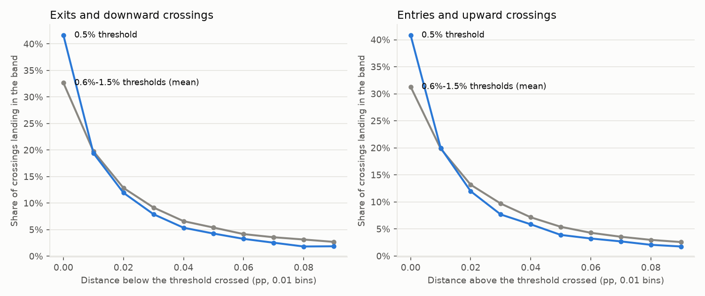
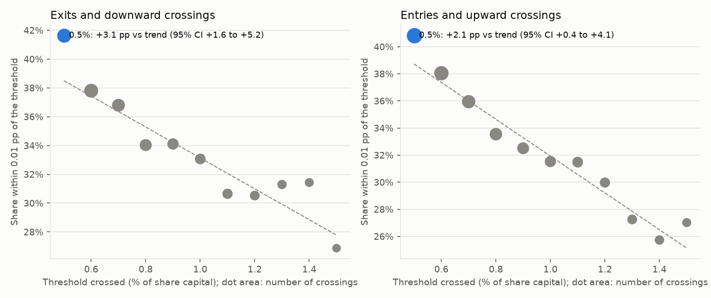
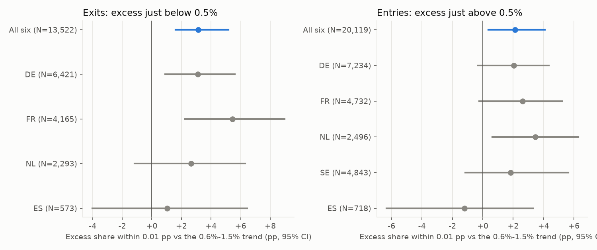
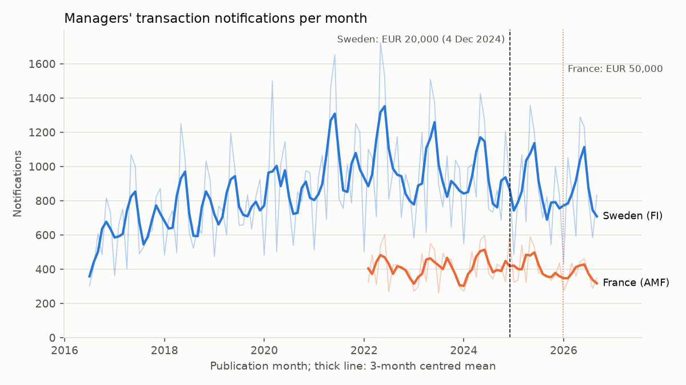
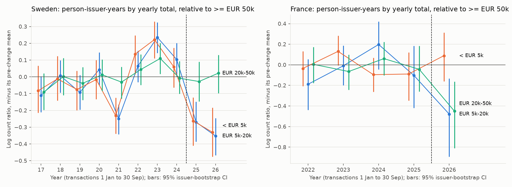
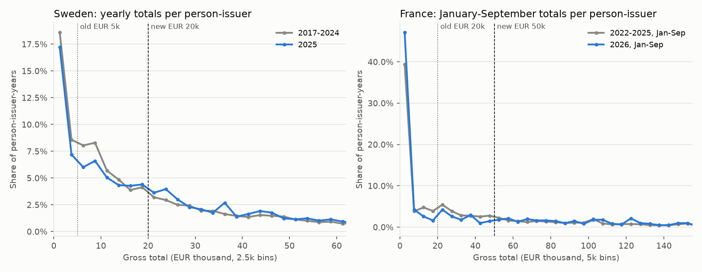
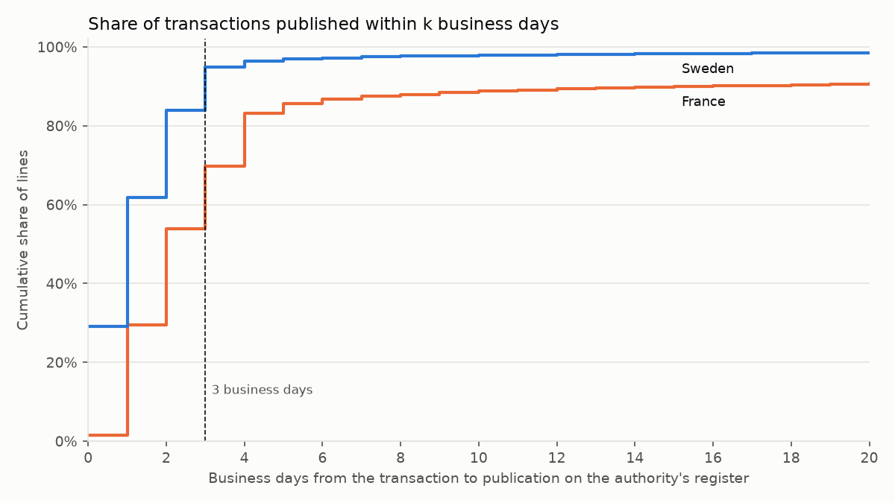
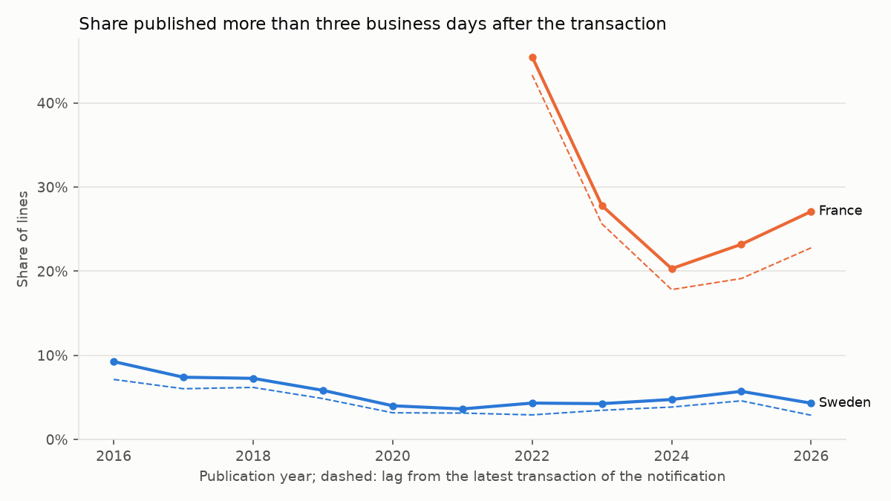

# Thresholds and regulation: short-position bunching, the Listing Act and filing lags

*EU Disclosure Atlas, workstream WS7. Samples: every public net short position notification of six
authorities (Germany, Spain, France, Ireland, the Netherlands and Sweden, 2010 to October 2026); every managers'
transaction published by Finansinspektionen (Sweden, July 2016 to October 2026) and by the AMF (France,
February 2021 to October 2026). Sample pinned at 20 October 2026. Research, not investment advice (see the end
of this page).*

## Summary

- **Short sellers leave few public traces of avoiding the 0.5% threshold.** In 177,480 public notifications
  from six authorities, exits (positions cut below 0.5%) land in [0.49%, 0.50%) slightly more often than
  downward crossings of 0.6% to 1.5% land just below those thresholds: **+3.1 percentage points** over a
  trend-predicted 38.5% (95% CI +1.6 to +5.2; +2.2 with a quadratic trend). That is about 8% more exits "just
  under the radar" than the mechanics predict, concentrated in France (+5.4 pp) and Germany (+3.1 pp).
  Entries show **no missing mass** just above 0.5%, the signature of a notch: if anything a small excess
  (+2.1 pp, not robust). Exits minus entries: +1.0 pp (CI −0.6 to +2.8). The bunching that Jank, Roling and
  Smajlbegovic (2021) find in confidential German data sits below 0.5%, where public files cannot look; among
  holders who do publish, avoidance at the margin is small.
- **Raising the managers' threshold removed a third of the small notifications, and not only the exempted
  ones.** In Sweden, after the Listing Act raised the yearly threshold from EUR 5,000 to EUR 20,000 on
  4 December 2024, monthly notifications fell **21%** (95% CI −29% to −12%) and person-issuer-years with EUR
  5,000-20,000 of transactions fell **27%** relative to those above EUR 50,000. Those below EUR 5,000, which
  were already exempt, fell just as much (−26%); the EUR 20,000-50,000 class did not move (−0.3%). In France,
  which already had EUR 20,000 since 2017, December 2024 changed nothing (placebo: +0.4% in volume), but the
  move to **EUR 50,000 on 27 December 2025** cut notifications by **12%** (CI −18% to −6%, the AMF expected
  about 12%) and the newly exempt EUR 20,000-50,000 class by **36%**.
- **No one bunches below the new thresholds.** The share of yearly totals just above EUR 20,000 (Sweden) or
  EUR 50,000 (France) did not change, so managers did not start trimming their trades to stay below.
- **Sweden publishes on time; France often does not.** 5.1% of mandatory Swedish transactions appear on
  FI's register more than three business days after the trade (4.1% counting from the latest trade in each
  notification), against **30.2%** (27.3%) on the AMF's register since February 2022, with 9.3% more than 20
  business days late. Lateness is higher for small trades in both countries and does not depend on the
  manager's seniority, except that the residual "other" roles are the latest in France (59%).

## 1. Questions and rules

Three disclosure thresholds and one deadline shape what European markets learn about short sellers and
managers:

| Rule | What it says | Source |
|---|---|---|
| SSR Article 5 | Net short positions in shares are notified to the authority (privately) from 0.2% of issued share capital and each 0.1% above; from 31 January 2022 the threshold is permanently 0.1% | Regulation (EU) No 236/2012; Commission Delegated Regulation (EU) 2022/27 (OJ L 6, 11.1.2022) |
| SSR Article 6 | Positions are published from 0.5% and at each 0.1% step above (0.6%, 0.7%...), including the crossing back below 0.5% | Regulation (EU) No 236/2012, Article 6(2) |
| MAR Article 19(8)-(9) | Managers (PDMRs) and closely associated persons notify their transactions once their total reaches a threshold within a calendar year, adding all transactions without netting; every subsequent transaction is then notified. EUR 5,000 until 3 December 2024; **EUR 20,000** from 4 December 2024 (Listing Act), with national options of EUR 10,000 or EUR 50,000 | Regulation (EU) No 596/2014; Regulation (EU) 2024/2809, Article 2(8) (OJ L, 14.11.2024; in force on the twentieth day after publication, 4 December 2024) |
| National choices | Sweden moved from EUR 5,000 to the new default EUR 20,000 on 4 December 2024 (FI is not on ESMA's list of changes). **France already had EUR 20,000 from 20 November 2017** (the original Article 19(9) option), so the Listing Act changed nothing there; the AMF then raised it to **EUR 50,000** from 27 December 2025 (General Regulation Article 223-23, arrêté of 4 December 2025, JORF of 26 December 2025). Germany and Denmark also chose EUR 50,000, Malta EUR 10,000 | ESMA70-154-1020 (19 January 2026); AMF General Regulation, Article 223-23, versions in force from 20 November 2017 and from 27 December 2025; Légifrance JORFTEXT000053165324 |
| MAR Article 19(1) and (3) | Notification "promptly and no later than three business days after the date of the transaction"; the issuer (or, under the Article 19(3) option, the authority) makes it public within the same three business days. The Listing Act did not change this deadline | Regulation (EU) No 596/2014 |

Questions:

1. **Do short sellers avoid the 0.5% publication threshold?** Jank, Roling and Smajlbegovic (2021) show with
   confidential German data that positions pile up just below 0.5%. Can public data from six countries detect
   the same behaviour?
2. **What do higher notification thresholds do to managers' notifications?** Sweden's move from EUR 5,000
   to EUR 20,000 (Listing Act) and France's from EUR 20,000 to EUR 50,000: how many fewer, which ones, and
   did managers start keeping yearly totals just below the new threshold?
3. **How often are notifications published late**, by country, role and size?

## 2. Data

**Net short positions.** The six registers documented in [docs/sources/](../../docs/sources/), ingested with
the project's connectors (`*_shorts`) on 20 October 2026. Each file holds current and historic positions.

| Authority | Notifications | From | Holders | Positions (holder × share) | Exit values |
|---|---:|---|---:|---:|---|
| BaFin (DE) | 62,152 | Jan 2010 | 484 | 4,245 | published |
| AMF (FR) | 41,163 | Oct 2012 | 382 | 2,320 | published |
| FI (SE) | 38,869 | May 2010 | 457 | 2,787 | "< 0.5%" only |
| AFM (NL) | 22,446 | Nov 2012 | 247 | 988 | published |
| CNMV (ES) | 12,299 | Jun 2010 | 228 | 819 | mostly published |
| CBI (IE) | 551 | Jan 2020 | 45 | 61 | mostly published |
| **Total** | **177,480** | | **915** | | |

- Positions dated before 1 November 2012 come from the national regimes that preceded the SSR. The results
  hold in each sub-period (section 3.3).
- Exit values ([table](results/shorts_exit_values.csv)): in Germany, 33% of exits land in [0.49%, 0.50%),
  69% in [0.45%, 0.50%), and 8% are closed to about zero. Sweden publishes "< 0.5%" without a value, so
  Swedish exits cannot enter the exit estimates (Swedish entries can).
- Holder names are normalised (upper case, punctuation removed); the same group under two spellings counts
  twice. Holders are almost all legal entities; no holder-level result is published.

**Managers' transactions.**

| Register | Lines (transactions) | Publications | Source note |
|---|---:|---|---|
| FI PDMR register (SE) | 153,846 | 4 July 2016 to 20 October 2026 | [se_fi_pdmr](../../docs/sources/se_fi_pdmr.md) |
| AMF BDIF (FR) | 48,970 from 28,257 PDF notifications | February 2021 to 20 October 2026 | [fr_amf_pdmr](../../docs/sources/fr_amf_pdmr.md) |

- Current records of the gold layer: amendments replace the records they correct. Amounts are converted to
  euros at ECB reference rates; the threshold uses gross amounts (no netting), as the regulation requires.
- The AMF's template parser read all but 12 French PDFs (a three-digit year in the date); they are left out.
- **French publication dates before February 2022 are unreliable.** BDIF re-stamped about 4,000 filings first
  published between February and November 2021 with the date 8 December 2021 (the original date survives
  only in the raw listing), and some in January 2022. The 8,037 lines published before 1 February 2022 are
  left out of the lag and monthly analyses; the threshold analysis uses transaction dates and is unaffected.
- A notification is one notifying person, one issuer and one publication instant; a notification can hold
  several transaction lines.

## 3. Short positions: bunching at 0.5%

### 3.1 What public data can identify

Public registers list positions only from 0.5%, so the mass of positions held *below* 0.5% (the bunching that
Jank, Roling and Smajlbegovic measure) is invisible here. What is public is every **crossing** of a 0.1%
step: entries above 0.5%, every move across 0.6%, 0.7% and so on, and (in five of six countries) the value of
the position on the day it falls back below 0.5%. If holders find publication costly, two traces follow:

- **Exits.** A holder who wants to leave the public list but keep the trade cuts the position to just under
  0.5% rather than further. Exit values should then bunch in [0.49%, 0.50%) more than values after downward
  crossings of 0.6%, 0.7%..., where nothing changes because the holder stays public.
- **Entries.** Publication is a notch (Kleven and Waseem, 2013): a holder who would sit at 0.51% is better off
  at 0.49%. Entry values should then show *missing* mass just above 0.5%.

The higher thresholds are the control group: the same reporting mechanics (a notification at each 0.1% step,
values rounded to 0.01 pp) without the change from private to public.

### 3.2 Method

- **Positions.** A position is one holder (name normalised) in one instrument (ISIN) in one jurisdiction;
  notifications are ordered by position date, and same-day duplicates keep the last one. Each notification
  is compared with the previous one of the same position: an *upward crossing* lands in a higher 0.1% band (a
  first appearance or a re-entry counts as coming from below 0.5%), a *downward crossing* in a lower one.
- **Distance.** For a crossing that lands within one 0.1 pp band of the threshold it crossed, k is the
  distance from that threshold in 0.01 pp bins (k = 0: within 0.01 pp; for exits, a value in [0.49%, 0.50%)).
  Exits that land deeper than 0.4% are kept in the descriptive tables but not in the estimates.
- **Bunching statistic** at each threshold c from 0.5% to 1.5%, two versions:
  - the share of in-band crossings at k = 0;
  - Kleven's normalised excess mass b: actual minus counterfactual count at k = 0, divided by the
    counterfactual, where the counterfactual is a quadratic in k fitted to log counts at k = 1 to 9
    (Saez, 2010; Chetty et al., 2011; Kleven, 2016).
- **Difference in bunching.** The statistic falls smoothly with the threshold level, because positions near
  0.5% move in smaller steps than positions near 1.5%. The counterfactual at 0.5% is therefore a linear trend
  in c fitted on 0.6% to 1.5% (weighted by the number of crossings) and extrapolated to 0.5%. The estimate is
  the actual statistic at 0.5% minus that extrapolation.
- **Inference.** 999 bootstrap samples drawing **holders** with replacement (all their positions and
  notifications), so dependence within a holder's strategy is kept; 95% percentile intervals.
- **Robustness.** Quadratic trend; controls 0.6% to 1.0% only; a two-bin window and a linear counterfactual
  in k for b; sub-periods; entries restricted to re-entries from a known value in [0.4%, 0.5%) (gradual
  crossings, comparable to crossings of 0.6%); and the contrast *exits minus entries* from one joint bootstrap,
  which nets out whatever makes 0.5% special for both directions.

### 3.3 Results

Full tables: [results/shorts_bunching.csv](results/shorts_bunching.csv) (every specification and country)
and [results/shorts_profile_by_threshold.csv](results/shorts_profile_by_threshold.csv).



The raw distribution of published values is a saw: every 0.1% step has a peak just above it (upward
crossings) and just below the next one (downward crossings). The peak at 0.50% is the tallest because every
position enters there. The question is whether 0.5% is special *beyond* those mechanics.



Crossings at 0.5% land closer to the threshold than crossings of higher steps, in both directions: 42% of
exits land within 0.01 pp below 0.5%, against 33% on average for the 0.6% to 1.5% steps. Part of this is
scale: smaller positions change in smaller steps. The trend across thresholds removes it.



All six jurisdictions pooled (difference with the trend extrapolated from 0.6%-1.5%, holder-bootstrap 95% CI):

| Direction | Statistic | At 0.5% | Counterfactual | Difference | 95% CI |
|---|---|---:|---:|---:|---|
| Exits (13,522 crossings, 733 holders) | share within 0.01 pp | 41.6% | 38.5% | **+3.1 pp** | +1.6 to +5.2 |
| | same, quadratic trend | | 39.5% | **+2.2 pp** | +0.4 to +4.4 |
| | same, controls 0.6%-1.0% | | 39.0% | **+2.6 pp** | +0.9 to +4.6 |
| | Kleven b (excess mass / counterfactual) | 0.34 | 0.24 | +0.10 | −0.04 to +0.25 |
| Entries (20,119 crossings, 896 holders) | share within 0.01 pp | 40.8% | 38.7% | +2.1 pp | +0.4 to +4.1 |
| | same, quadratic trend | | 39.7% | +1.1 pp | −0.9 to +3.3 |
| | Kleven b | 0.30 | 0.21 | +0.08 | −0.05 to +0.20 |
| | Kleven b, 0.5% entries from a known value in [0.4%, 0.5%) | 0.40 | 0.21 | +0.19 | −0.00 to +0.40 |
| Exits minus entries | share within 0.01 pp | | | +1.0 pp | −0.6 to +2.8 |



By jurisdiction (share within 0.01 pp, difference with trend):

| | Exits | 95% CI | Entries | 95% CI |
|---|---:|---|---:|---|
| Germany | +3.1 pp | +0.9 to +5.6 | +2.0 pp | −0.3 to +4.4 |
| France | +5.4 pp | +2.3 to +9.0 | +2.6 pp | −0.2 to +5.2 |
| Netherlands | +2.7 pp | −1.2 to +6.3 | +3.4 pp | +0.6 to +6.3 |
| Spain | +1.0 pp | −4.0 to +6.5 | −1.2 pp | −6.3 to +3.3 |
| Sweden | (no exit values) | | +1.8 pp | −1.1 to +5.6 |
| Ireland | (too few) | | (96 crossings) | |

Reading:

- **Exits.** A small, robust excess of exits lands just below 0.5%: about 420 of 13,500 exits, or 8% more
  than the trend predicts. It is what a holder does who wants off the public list without closing the trade.
  It is strongest in France and Germany, the two largest registers.
- **Entries.** A notch predicts missing mass just above 0.5%. There is none: entries land at 0.50% as often
  as, or slightly more often than, the mechanics predict. Holders who cross do not jump over a dominated
  region.
- **Both together.** Exits and entries are both a little above trend, so part of the exit excess may be
  whatever else makes 0.5% special (it is the first public step, and positions near it are the smallest).
  Net of entries, the exit excess is +1.0 pp and not significant.
- **Kleven's b** points the same way but is too noisy to separate from zero: its counterfactual extrapolates
  a fitted curve into the bin next to the threshold, where the curve is steepest.
- **Over time** (Kleven b, pooled): 2010-2016 +0.13, 2017-2021 +0.08, 2022-2026 +0.10, all with intervals
  covering zero. The tighter private notification threshold of 2022 (0.1%) left no visible mark.

How this relates to Jank, Roling and Smajlbegovic (2021): their bunching is a *stock* of positions held
between the private and public thresholds, and many of their avoiders never publish at all. Public data see
only holders who already publish, and among them the strategic margin (exits just under 0.5%) is real but
small. The two results are consistent: the investors who care most about secrecy never appear in public
files, which is exactly why public data understate avoidance.

## 4. Higher managers' thresholds: Sweden (EUR 5,000 to 20,000) and France (EUR 20,000 to 50,000)

### 4.1 Design

The threshold applies to each person's yearly total in an issuer's instruments, so the unit is the
**person-issuer-year**: one notifying person (a manager, or a closely associated person, who notifies
separately), one issuer, one year. To compare years with the partial 2026, every year uses transactions from
1 January to 30 September, which the registers had published by 20 October.

- **Size classes by yearly total:** below EUR 5,000, EUR 5,000-20,000, EUR 20,000-50,000 and EUR 50,000 or
  more (mandatory throughout in both countries: the **reference**).
  - Sweden: the EUR 5,000-20,000 class is **treated** from 2025 (mandatory before, exempt after); below EUR
    5,000 was voluntary in both regimes; EUR 20,000-50,000 stayed mandatory (a placebo class).
  - France: the EUR 20,000-50,000 class is **treated** in 2026; both classes below EUR 20,000 were voluntary
    throughout. 2025 is a **placebo year** (the Listing Act changed nothing in France) and is kept out of the
    pre-period, which is 2022-2024.
- **Difference in differences** on log counts of person-issuer-years: the change from the pre-period mean to
  the post-period mean in each class, minus the same change in the reference class. Year-by-year deviations
  give an event-study path. Standard errors: 999 bootstrap samples drawing **issuers** with replacement.
- **Placebo dates:** the same estimator with fake change years inside the pre-period, to see how large a
  two-year swing between size classes is without any rule change. The issuer bootstrap does not capture such
  year-level shocks, so these placebos are the more honest yardstick.
- **Interrupted time series** of monthly notifications: Poisson regression on calendar-month dummies, a linear
  trend and a post-change dummy (December 2024, which straddles the change, is dropped), Newey-West errors.
  Sweden from January 2018; France from February 2022, with a 2025 placebo dummy and a 2026 dummy.
- **Bunching at the new threshold:** if people now avoid crossing it, the share of totals just above it among
  all totals above it should fall after the change. Sweden: full calendar years, [EUR 20k, 25k) among
  [20k, 100k), 2017-2024 against 2025. France: January-September totals, [EUR 50k, 60k) among [50k, 200k),
  2022-2025 against 2026. Totals just below the new threshold are voluntary after the change.
- **Heterogeneity:** the DiD within roles, for managers and closely associated persons separately, for
  person-years with only market trades versus those with grants, exercises or subscriptions, and with
  closely associated persons' transactions added to their manager's total.

### 4.2 Results

Tables: [listing_did.csv](results/listing_did.csv), [listing_its.csv](results/listing_its.csv),
[listing_placebo_dates.csv](results/listing_placebo_dates.csv),
[listing_bunching_new_threshold.csv](results/listing_bunching_new_threshold.csv),
[listing_composition.csv](results/listing_composition.csv).



**Volume (interrupted time series).**

| | Change in monthly notifications | 95% CI |
|---|---:|---|
| Sweden, from January 2025 (EUR 20,000) | **−20.8%** | −29.0% to −11.7% |
| France, 2025 (placebo: no change in France) | +0.4% | −6.8% to +8.2% |
| France, from January 2026 (EUR 50,000) | **−11.9%** | −17.6% to −5.7% |

Raw averages tell the same story: Sweden went from 950 notifications a month (January 2023 to November 2024)
to 861 (January 2025 to September 2026); France from 405 a month in 2025 to 369 in January-September 2026.
The French drop matches the AMF's own forecast ("around 12%" fewer notifications, ESMA70-154-1020).



**Who stopped notifying (person-issuer-years, change relative to >= EUR 50,000, issuer-bootstrap 95% CI).**

| Class (yearly total, Jan-Sep) | Sweden, 2025-2026 | France, 2025 (placebo) | France, 2026 (EUR 50,000) |
|---|---:|---:|---:|
| < EUR 5,000 | **−25.7%** (−34.3 to −16.3) | −8.6% (−29.4 to +12.8) | +9.3% (−14.8 to +37.0) |
| EUR 5,000-20,000 | **−26.7%** (−33.2 to −19.5) | −9.8% (−34.3 to +20.2) | **−38.0%** (−59.1 to −12.5) |
| EUR 20,000-50,000 | −0.3% (−9.2 to +9.3) | −4.3% (−22.8 to +20.2) | **−36.3%** (−55.5 to −15.1) |

- **Sweden.** The newly exempt EUR 5,000-20,000 class fell by about a quarter, and the class that stayed
  mandatory (EUR 20,000-50,000) did not move: the threshold bit where the law says it should. But the
  person-years below EUR 5,000, which never had to be notified, fell just as much. So the decline is not
  only the legal exemption. A plausible reading is that many issuers had a policy of notifying every
  transaction, and the Listing Act's publicity ended those voluntary notifications too.
- **France** gives a clean contrast. Nothing moved in 2025, when France's rule did not change. In 2026 the
  newly exempt EUR 20,000-50,000 class fell by a third, and so did the already voluntary EUR 5,000-20,000
  class, echoing the Swedish pattern; only the smallest totals did not fall.
- **Caution on the Swedish timing.** Year-to-year swings between size classes are large in Sweden even
  without any rule change. Fake change dates inside 2017-2024 give estimates for the EUR 5,000-20,000 class
  between −5% and +26% ([placebo dates](results/listing_placebo_dates.csv)): the 2022-2023 boom in small
  trades is as large, with the opposite sign, as the post-2024 drop. The issuer bootstrap does not see such
  year-level shocks, so the Swedish intervals above are too narrow; the French placebo year and the stable
  EUR 20,000-50,000 class are the stronger evidence.

**Heterogeneity** (newly exempt class; full table in [listing_did.csv](results/listing_did.csv)):

| Subgroup | Sweden, EUR 5k-20k | France 2026, EUR 20k-50k |
|---|---:|---:|
| CEO/CFO | **−38.8%** | −35.4% |
| Chair and board | **−23.0%** | **−46.5%** |
| Other managers | **−21.4%** | −18.4% |
| Managers themselves | **−24.0%** | **−35.8%** |
| Closely associated persons | **−37.6%** | −44.3% |
| Market trades only | **−19.0%** | **−48.1%** |
| With grants, exercises or subscriptions | **−34.1%** | −0.3% |
| Manager and associates pooled in one total | **−27.5%** | **−38.2%** |

Bold: 95% interval excludes zero. In Sweden, notifications by closely associated persons and those involving
incentive-plan instruments (grants, exercises, subscriptions) fell most; in Sweden even the closely associated
persons' EUR 20,000-50,000 class fell (−22.5%), consistent with families stopping voluntary filings. In
France the drop is concentrated in market trades of managers and board members.



**No bunching below the new threshold.**

| | Share just above the new threshold, before | After | Difference (95% CI) |
|---|---:|---:|---|
| Sweden, [EUR 20k, 25k) among [20k, 100k) | 16.2% | 16.9% | +0.7 pp (−1.5 to +2.9) |
| France, [EUR 50k, 60k) among [50k, 200k) | 14.0% | 12.9% | −1.1 pp (−6.6 to +4.8) |

Neither country shows missing mass just above the new threshold, so managers did not start trimming their
trades to stay below it. Below the threshold the picture is mechanical: in Sweden, the share of totals
between EUR 2,500 and 10,000 fell (no longer required), while in France totals just below EUR 50,000 fell
from 5.3% to 2.5% of all person-years (−2.9 pp, CI −4.4 to −1.4) because they no longer have to be
notified.

**Composition.** In Sweden, the share of notifications below EUR 20,000 fell from 58.9% (2023 to November
2024) to 51.6% (2025 to September 2026), and the median notification rose from EUR 11,900 to EUR 18,400. Half
of Swedish notifications are still below EUR 20,000, so voluntary or below-threshold notifying remains
common. The share of CEO and CFO notifications rose slightly (26.6% to 28.4%). In France the median
notification rose from EUR 22,900 (2025) to EUR 28,200 (January-September 2026).

## 5. Filing lags and the three-business-day rule

### 5.1 Measure

The lag is the number of business days from the transaction date to publication on the authority's
register: FI's PDMR register in Sweden, BDIF in France. Business days are national working days (weekends,
public holidays and, in Sweden, Midsummer Eve, Christmas Eve and New Year's Eve). A publication more than
three business days after the transaction is **late**.

- Both deadlines (the person's notification and the publication) run from the transaction, so a late
  publication means at least one of them was missed, unless the authority's own processing caused it.
- **Mandatory notifications only:** lines of person-issuer-years whose yearly total reaches the threshold in
  force. Below it, notifying is voluntary and no deadline applies.
- **Line versus notification level.** Once the yearly threshold is reached, earlier transactions of the year
  are often notified together with the one that reached it, and their line-level lag looks late. The
  notification-level measure counts from the latest transaction in the notification; it is the lower bound.
- Excluded: amendments (they correct earlier notifications and are published later by nature) and lags over
  365 calendar days (mostly typing errors in the transaction date).
- Issuer size proxy: whether the issuer's shares trade on a main regulated market or on a growth market or
  MTF (First North, Spotlight, NGM; Euronext Growth), from its most frequent venue.

### 5.2 Results

Tables: [lags_overall.csv](results/lags_overall.csv), [lags_by_year.csv](results/lags_by_year.csv),
[lags_by_group.csv](results/lags_by_group.csv), [lags_models.csv](results/lags_models.csv).



| | Sweden | France |
|---|---:|---:|
| Mandatory transaction lines | 125,961 | 35,769 |
| Median lag (business days) | 1 | 2 |
| Published within 3 business days | 94.9% | 69.8% |
| **Late**, line level | **5.1%** | **30.2%** |
| Late, notification level (lower bound) | 4.1% | 27.3% |
| More than 20 business days late | 1.5% | 9.3% |
| 90th percentile of the lag | 3 | 16 |



- **Over time.** Sweden improved from 9.3% late in 2016 to about 4% from 2020, with a bump to 5.7% in 2025.
  France fell from 45% in 2022 (residual effects of the register migration are possible, see section 2) to
  20% in 2024, then rose again to 23% in 2025 and 27% in 2026.
- **By trade size.** Small trades are late more often: in Sweden 7.0% of lines below EUR 5,000 against 2.9%
  above EUR 100,000; in France 36% against 21-27%.
- **By role.** No gradient in Sweden (4.5% to 5.3%). In France, CEOs and CFOs are the most punctual (22.7%)
  and the residual "other" category the least (59.0%).
- **By issuer size.** In Sweden, growth-market issuers are late twice as often as main-market issuers (6.9%
  against 3.6%). In France the difference is small and goes the other way (26.9% against 31.3%).
- **Closely associated persons** are slightly later in both countries (Sweden 5.6% against 4.9%; France 33.3%
  against 28.0%).

**Linear probability model** of a late line (mandatory notifications, publication-year dummies, standard
errors clustered by issuer): being Swedish lowers the probability by **25.3 points** (s.e. 3.4) once role,
size, segment, closely associated persons and market trades are held fixed. Trades below EUR 5,000 are 4.3
points (1.6) more likely to be late than trades of EUR 20,000-100,000, and trades of EUR 100,000 to 1 million
1.8 points (0.7) less likely. Role and segment effects are not significant once country and size are held
fixed. The logit's average marginal effects are similar.

Two cautions. France's lag includes the AMF's processing time between receipt and publication, which the
data cannot separate from late notification; so the French figures are an upper bound on non-compliance by
managers. And the line-level measure counts earlier small transactions that are notified legitimately late,
once the yearly threshold is reached; the notification-level measure removes that and changes little.

## 6. Related literature

- **Jank, Roling and Smajlbegovic (2021, *Journal of Financial Economics* 139(1), 209-233), "Flying under
  the radar".** With confidential German data that include positions below the publication threshold, they
  find that short positions accumulate just below 0.5% and that some investors never disclose any position.
  The evidence points to secrecy about strategies (protection against reverse engineering by competitors)
  rather than fear of short squeezes, recalls or lending fees, and the avoidance slows price discovery.
  Section 3 is the public-data counterpart. It cannot see the stock of hidden positions, the core of their
  result, but it can test the margins that leave public traces, and it finds them small.
- **Saez (2010, *American Economic Journal: Economic Policy*); Chetty, Friedman, Olsen and Pistaferri (2011,
  *Quarterly Journal of Economics*); Kleven and Waseem (2013, *Quarterly Journal of Economics*); Kleven (2016,
  *Annual Review of Economics*).** Bunching estimators at kinks and notches: polynomial counterfactuals,
  excess and missing mass, and bootstrap inference. Section 3 adapts them to a setting where the bunching
  region itself is unobserved, using the thresholds above 0.5% as a control group ("difference in
  bunching").
- **Managers' trades and disclosure.** Seyhun (1986, *Journal of Financial Economics*), Lakonishok and Lee
  (2001, *Review of Financial Studies*) and, for Europe, Fidrmuc, Goergen and Renneboog (2006, *Journal of
  Finance*) and Betzer and Theissen (2009, *European Financial Management*) show that managers' purchases are
  informative; the project's WS6 study finds the same in Sweden, including after December 2024. The Listing
  Act's recital 74 justifies the higher threshold by notifications "which would not be meaningful to
  investors". Section 4 measures how many disappeared; whether they were informative is the next question.
- **Late filing.** For US insiders, Cheng, Nagar and Rajan (2007, *Review of Financial Studies*) study trades
  whose disclosure was delayed under the pre-2002 rules and the information they carried; Sarbanes-Oxley
  Section 403 then set a two-business-day deadline for Form 4. Section 5 is a European measurement of the
  same margin.
- **Method.** Newey and West (1987, *Econometrica*) for autocorrelation-robust errors; cluster bootstrap
  (Cameron, Gelbach and Miller, 2008, *Review of Economics and Statistics*).

## 7. Limitations

- **Public short data cannot see below 0.5%.** The estimates in section 3 test the margins that leave
  public traces (exits and entries). They say nothing about positions that never reach 0.5%, the core of
  Jank, Roling and Smajlbegovic's evidence. A small exit excess is therefore a lower bound on avoidance, not
  an estimate of it.
- **Mechanics versus behaviour at 0.5%.** The counterfactual extrapolates the trend from 0.6%-1.5% down to
  0.5%. With a quadratic trend the exit excess shrinks from 3.1 to 2.2 pp and the entry excess disappears;
  the Kleven b statistic is too noisy to separate from zero. The result is "small and fragile at entry,
  small and robust at exit", not "large".
- **Holder identity** rests on normalised names; a holder that changes its legal name starts a new position,
  and a first appearance counts as an entry from below. Sweden's exits have no values, and Ireland's register
  is too small for country estimates.
- **Few years, few countries for the threshold change.** Sweden has two post-change years and France one, and
  year-level shocks (the 2021-2023 swing in small trades) are as large as the effects. The issuer bootstrap
  understates that uncertainty; the placebo dates and France's placebo year are the honest yardsticks. Market
  conditions that change the size mix of trades (an IPO boom, a crash) are absorbed only insofar as they
  move all classes alike.
- **Totals are measured with error.** Yearly totals are summed from published notifications, so a person
  who stops notifying disappears instead of moving to a lower class: the analysis measures notifications,
  not trading. Zero-price grants count as zero, while the threshold should value them at market price, so
  some incentive-plan totals are understated. Comparing years uses January-September transactions; full-year
  totals differ, and are used only for the Swedish bunching test.
- **Which persons share a threshold.** The regulation's total covers "all transactions" of the notifying
  person. We treat managers and closely associated persons separately (as they notify separately) and, as a
  robustness check, pooled; the results barely change.
- **Lags.** The publication date is the register's, not the notification's. Authority processing time,
  weekends and holidays not in our calendars (bank holidays specific to some regions), and the end of the
  BDIF migration in 2022 can all inflate French lags. The 365-day cap removes typing errors but also a few
  genuine very late notifications.
- **Scope.** Two countries for managers' transactions (the others follow as their connectors land, WS2 and
  WS3); six for short positions (Italy's Consob blocks automated access).

## 8. Reproduce

From a clean clone, at the repository root:

```bash
python3.14 -m venv .venv && source .venv/bin/activate && pip install -e '.[dev,research,shorts]'
python research/thresholds/run.py --backfill --until 2026-10-20
```

- **Steps.** `--backfill` ingests the six short-position registers (single files, minutes), the FI register
  year by year (the WS6 script, one to two hours) and the AMF register in chunks
  ([backfill_fr.sh](backfill_fr.sh): about 5,000 PDF notifications a year at one request per second, roughly
  ten hours in total). All backfills are resumable. The script then writes `results/` and `figures/`.
- **Several lakes.** `--lake` can be repeated, e.g. `--lake lake --lake lake-fr` when the French register was
  ingested into its own lake; each lake contributes the tables it has.
- **Parts.** `--part shorts|listing|lags` re-runs one section; `--reps` sets the bootstrap replications (999).
- **Pinned and moving inputs.** `--until 2026-10-20` pins the sample. Registers revise and occasionally
  delete notifications, so a later download can differ slightly.
- **Tests.** `pytest research/thresholds/tests` runs the study's offline tests on synthetic data.
- **What is committed.** Only code, aggregated tables (`results/`) and figures. The lake, raw files and
  position- or person-level data stay local. Position holders are mostly legal entities, but no holder-level
  result is published either.

Sources and re-use: FI open data (Source: Finansinspektionen); AMF BDIF ("©Autorité des marchés financiers –
droits réservés", non-commercial re-use with source and date); BaFin, CNMV, AMF, CBI, AFM and FI short-position
registers as documented in [docs/sources/](../../docs/sources/). Retrieved 20 October 2026.

## Not investment advice

This is academic-style research on public data. It describes average historical patterns with known
biases. It is not a recommendation to buy or sell any security or to take or avoid any short position, and
nothing here should be used to place orders.
